# Carte du réseau des الكفاءات — cycle moyen (1AM–4AM)

> **Généré** par `scripts/generate-learning-net-map.mjs` — ne pas éditer à la main.
> Contrat et règles : [`docs/architecture/LEARNING_NET.md`](../architecture/LEARNING_NET.md).
> Données : `packages/core/curriculum/dz/net/`.

**224** items du programme officiel · **28** مقاطع · **17** fils conceptuels · **354** liens (313 requires, 31 extends, 10 consolidates) · **112** leçons publiées · **158** leçons prévues (39 unités 1AM–3AM).

Légende des liens : `requires` (يتطلّب) — prérequis, lien de révision ; `extends` (يمدّد) — même notion plus loin dans la spirale, la leçon n’enseigne QUE la valeur ajoutée ; `consolidates` (يرسّخ) — le programme répète l’item, la leçon le rappelle sans le reconstruire.

## 1. Les fils conceptuels (la spirale, année par année)

### الأعداد الطبيعية والعشرية والعمليات — `naturals-decimals`

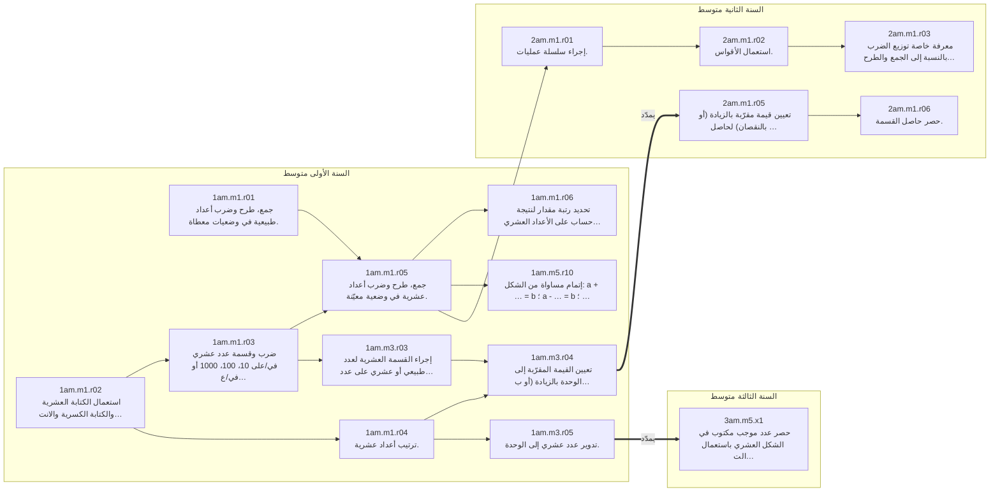

Prérequis venus d’autres fils : `1am.m3.r01`.

### القسمة والقواسم — `divisibility`

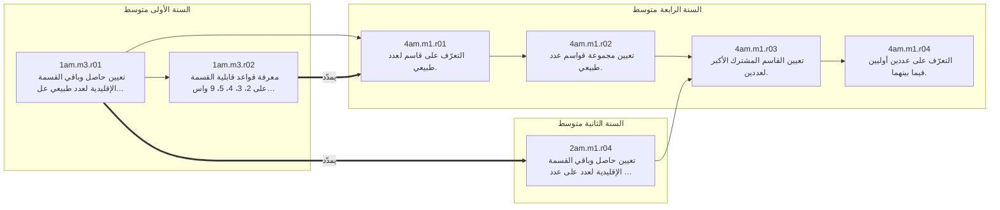

Prérequis venus d’autres fils : `1am.m1.r01`.

### الكسور والأعداد الناطقة — `fractions-rationals`

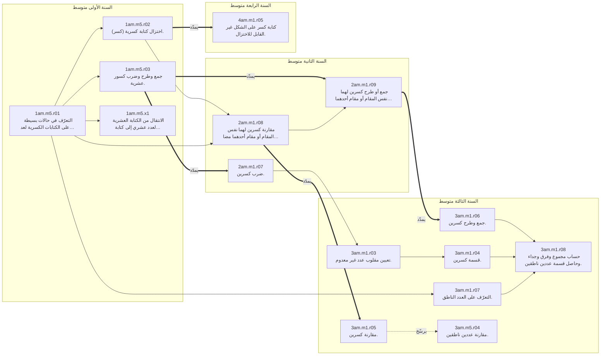

Prérequis venus d’autres fils : `1am.m1.r02`, `1am.m3.r02`, `1am.m1.r05`, `3am.m1.r02`, `3am.m1.r01`, `4am.m1.r03`, `4am.m1.r04`.

### الأعداد النسبية والمستقيم المدرّج والمعلم — `relatives-line-frame`

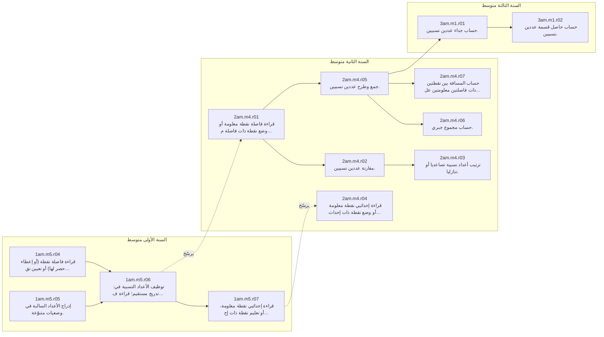

Prérequis venus d’autres fils : `1am.m1.r04`, `2am.m1.r02`.

### القوى والجذور — `powers-roots`

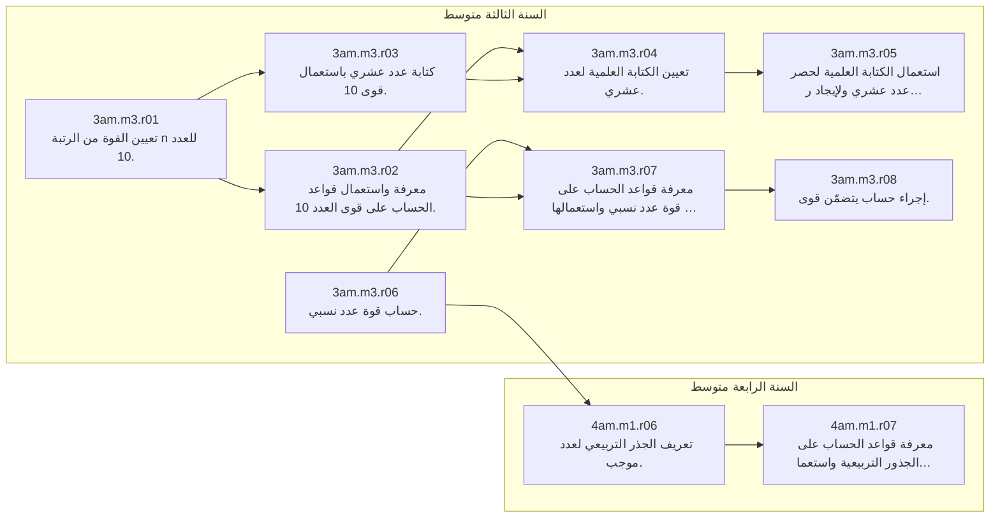

Prérequis venus d’autres fils : `1am.m1.r03`, `1am.m1.r06`, `3am.m1.r01`, `2am.m1.r01`, `3am.m4.r03`, `3am.m5.r01`.

### الحساب الحرفي — `literal-calculus`

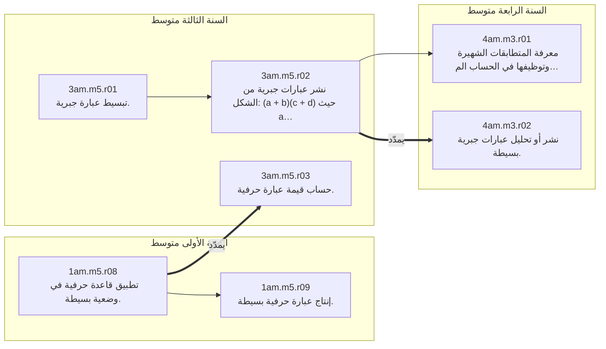

Prérequis venus d’autres fils : `1am.m2.r08`, `2am.m1.r03`, `3am.m1.r08`, `3am.m1.r01`.

### المعادلات والمتراجحات والجمل — `equations`

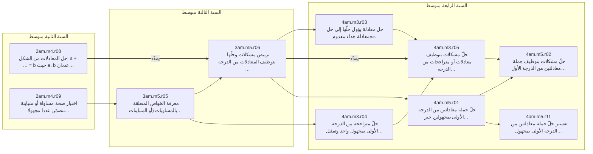

Prérequis venus d’autres fils : `1am.m5.r10`, `1am.m5.r08`, `2am.m4.r06`, `3am.m1.r01`, `3am.m5.r01`, `4am.m3.r02`, `2am.m4.r03`, `4am.m5.r08`.

### التناسبية والدوال — `proportionality-functions`

```mermaid
flowchart LR
  subgraph g_1am["السنة الأولى متوسط"]
    direction TB
    n_1am_m6_r01["1am.m6.r01<br/>التعرّف على وضعيات تناسبية أو لا تناسبية في أمث…"]
    n_1am_m6_r02["1am.m6.r02<br/>ترجمة نصّ إلى جدول منظّم."]
    n_1am_m6_r03["1am.m6.r03<br/>تمييز جدول تناسبية من جدول لا تناسبية."]
    n_1am_m6_r04["1am.m6.r04<br/>إتمام جدول تناسبية بطرائق مختلفة."]
    n_1am_m6_r05["1am.m6.r05<br/>مقارنة حصص."]
    n_1am_m6_r06["1am.m6.r06<br/>تطبيق نسبة مئوية في حالات بسيطة."]
    n_1am_m6_r07["1am.m6.r07<br/>استعمال مفهوم المقياس في وضعيات بسيطة للتكبير أ…"]
    n_1am_m6_r08["1am.m6.r08<br/>استعمال مقياس مخطّط أو خريطة لتعيين مسافة على م…"]
  end
  subgraph g_2am["السنة الثانية متوسط"]
    direction TB
    n_2am_m6_r01["2am.m6.r01<br/>التعرّف على وضعية تناسبية من جدول أعداد."]
    n_2am_m6_r02["2am.m6.r02<br/>إتمام جدول أعداد يمثّل تناسبية."]
    n_2am_m6_r03["2am.m6.r03<br/>تعيين الرابع المتناسب."]
    n_2am_m6_r04["2am.m6.r04<br/>حساب نسبة مئوية وتوظيفها."]
    n_2am_m6_r05["2am.m6.r05<br/>حساب مقياس خريطة أو تصميم واستعماله."]
  end
  subgraph g_3am["السنة الثالثة متوسط"]
    direction TB
    n_3am_m7_r01["3am.m7.r01<br/>التعرّف على وضعية تناسبية في تمثيل بياني."]
    n_3am_m7_r06["3am.m7.r06<br/>استعمال التناسبية في وضعيات تدخل فيه النسبة الم…"]
  end
  subgraph g_4am["السنة الرابعة متوسط"]
    direction TB
    n_4am_m5_r03["4am.m5.r03<br/>الدالة الخطية:"]
    n_4am_m5_r04["4am.m5.r04<br/>تمثيل دالة خطية بيانيا."]
    n_4am_m5_r05["4am.m5.r05<br/>قراءة التمثيل البياني لدالة خطية."]
    n_4am_m5_r06["4am.m5.r06<br/>حساب معامل الدالة الخطية انطلاقا من تمثيلها الب…"]
    n_4am_m5_r07["4am.m5.r07<br/>الدالة التآلفية:"]
    n_4am_m5_r08["4am.m5.r08<br/>تمثيل دالة تآلفية بيانيا."]
    n_4am_m5_r09["4am.m5.r09<br/>قراءة التمثيل البياني لدالة تآلفية."]
    n_4am_m5_r10["4am.m5.r10<br/>تعيين المعاملين a و b انطلاقا من التمثيل البيان…"]
    n_4am_m5_r12["4am.m5.r12<br/>تمثيل وقراءة وترجمة وضعية يتدخّل فيها مقدار معط…"]
    n_4am_m5_r13["4am.m5.r13<br/>إنجاز تمثيل بياني لوضعية يتدخّل فيها مقداران أح…"]
    n_4am_m5_r14["4am.m5.r14<br/>حلّ مشكلات تتدخّل فيها النسبة المئوية أو المقاد…"]
  end
  n_1am_m6_r01 --> n_1am_m6_r03
  n_1am_m6_r02 --> n_1am_m6_r03
  n_1am_m6_r03 --> n_1am_m6_r04
  n_1am_m6_r04 --> n_1am_m6_r05
  n_1am_m6_r04 --> n_1am_m6_r06
  n_1am_m6_r04 --> n_1am_m6_r07
  n_1am_m6_r07 --> n_1am_m6_r08
  n_1am_m6_r03 -.->|يرسّخ| n_2am_m6_r01
  n_1am_m6_r04 -.->|يرسّخ| n_2am_m6_r02
  n_2am_m6_r02 --> n_2am_m6_r03
  n_2am_m6_r03 --> n_2am_m6_r04
  n_1am_m6_r06 ==>|يمدّد| n_2am_m6_r04
  n_2am_m6_r03 --> n_2am_m6_r05
  n_1am_m6_r08 ==>|يمدّد| n_2am_m6_r05
  n_2am_m6_r01 --> n_3am_m7_r01
  n_2am_m6_r04 -.->|يرسّخ| n_3am_m7_r06
  n_3am_m7_r01 --> n_4am_m5_r03
  n_2am_m6_r03 --> n_4am_m5_r03
  n_4am_m5_r03 --> n_4am_m5_r04
  n_3am_m7_r01 --> n_4am_m5_r04
  n_4am_m5_r04 --> n_4am_m5_r05
  n_4am_m5_r05 --> n_4am_m5_r06
  n_4am_m5_r03 --> n_4am_m5_r07
  n_4am_m5_r07 --> n_4am_m5_r08
  n_4am_m5_r04 --> n_4am_m5_r08
  n_4am_m5_r08 --> n_4am_m5_r09
  n_4am_m5_r05 --> n_4am_m5_r09
  n_4am_m5_r09 --> n_4am_m5_r10
  n_4am_m5_r06 --> n_4am_m5_r10
  n_4am_m5_r05 --> n_4am_m5_r12
  n_3am_m7_r01 --> n_4am_m5_r12
  n_4am_m5_r12 --> n_4am_m5_r13
  n_4am_m5_r05 --> n_4am_m5_r13
  n_4am_m5_r03 --> n_4am_m5_r14
  n_3am_m7_r06 ==>|يمدّد| n_4am_m5_r14
```

Prérequis venus d’autres fils : `1am.m1.r05`, `1am.m5.r01`, `1am.m5.r03`, `2am.m4.r04`, `3am.m5.r03`, `3am.m7.r04`.

### المقادير ووحداتها — `measures-units`

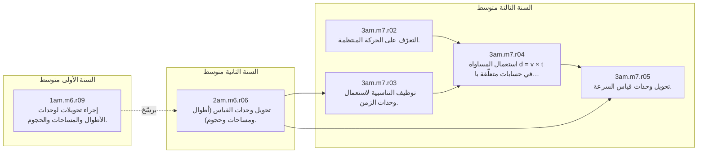

Prérequis venus d’autres fils : `1am.m1.r03`, `3am.m7.r01`.

### الإحصاء وتنظيم المعطيات — `statistics`

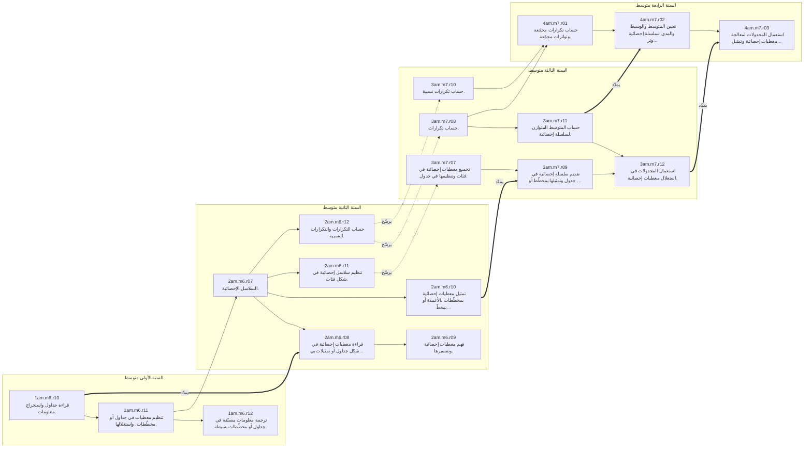

Prérequis venus d’autres fils : `1am.m6.r02`, `2am.m6.r04`, `1am.m4.r04`, `2am.m1.r01`.

### الأشكال المستوية والإنشاءات — `plane-figures`

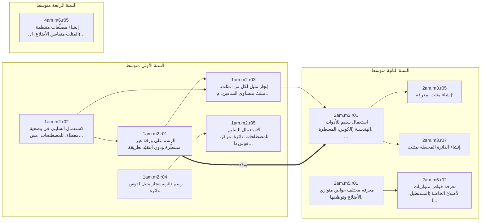

Prérequis venus d’autres fils : `1am.m4.r10`, `1am.m4.r11`, `1am.m4.r04`, `2am.m2.r05`, `2am.m3.r03`, `1am.m4.r09`, `4am.m6.r02`, `4am.m6.r04`.

### الزوايا — `angles`

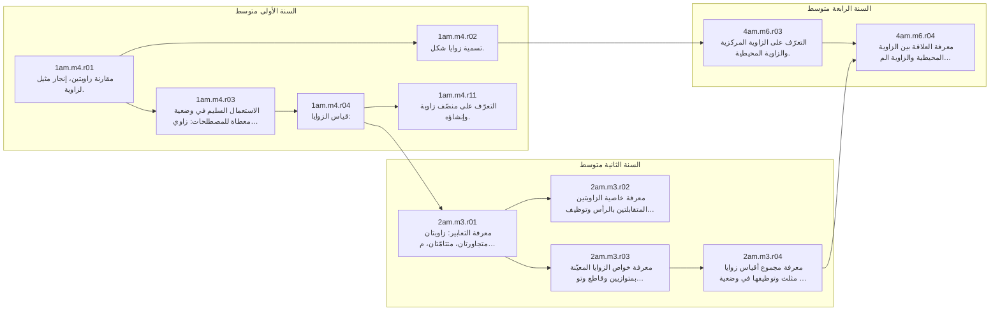

Prérequis venus d’autres fils : `1am.m2.r02`, `1am.m4.r08`, `2am.m2.r05`, `1am.m2.r05`.

### الأطوال والمحيطات والمساحات — `lengths-areas`

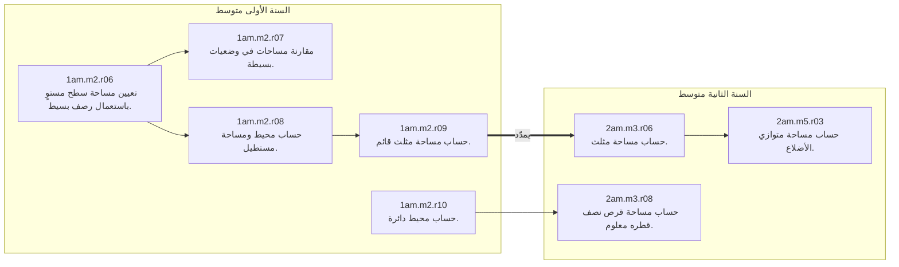

Prérequis venus d’autres fils : `1am.m1.r05`, `1am.m2.r03`, `1am.m2.r05`, `2am.m5.r01`.

### التحويلات النقطية والأشعة — `transformations`

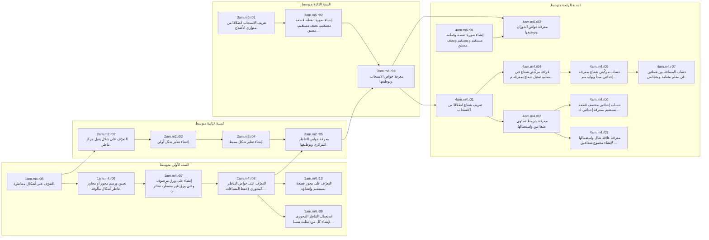

Prérequis venus d’autres fils : `1am.m2.r03`, `1am.m2.r01`, `2am.m5.r01`, `2am.m4.r04`, `2am.m4.r07`, `3am.m4.r03`, `4am.m1.r06`, `1am.m4.r04`, `2am.m2.r01`.

### المثلثات والبرهان — `triangles-proof`

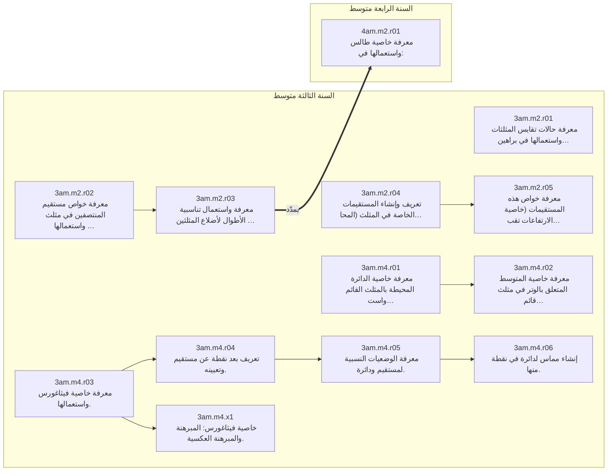

Prérequis venus d’autres fils : `2am.m3.r05`, `2am.m2.r05`, `2am.m5.r01`, `1am.m2.r01`, `2am.m6.r03`, `2am.m2.r01`, `2am.m3.r07`, `2am.m5.r02`, `1am.m2.r08`, `3am.m3.r06`, `1am.m2.r05`, `3am.m1.r08`.

### حساب المثلثات — `trigonometry`

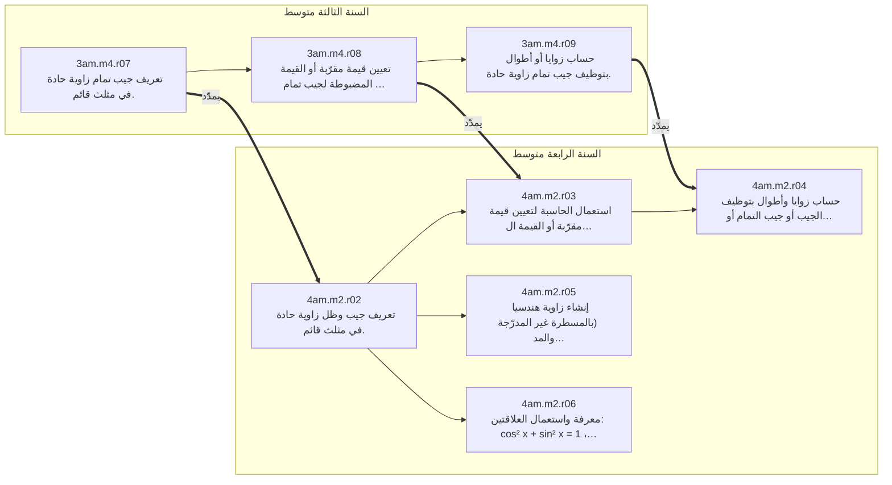

Prérequis venus d’autres fils : `3am.m2.r03`, `2am.m6.r03`, `2am.m2.r01`, `3am.m4.r03`, `4am.m1.r07`.

### المجسّمات والهندسة في الفضاء — `solids`

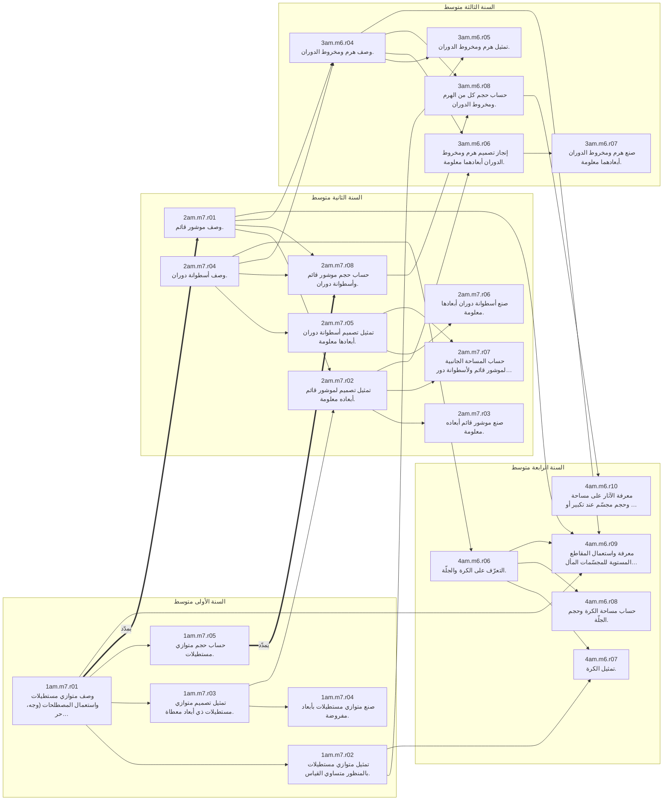

Prérequis venus d’autres fils : `1am.m2.r03`, `1am.m1.r05`, `1am.m2.r05`, `1am.m2.r10`, `1am.m2.r08`, `2am.m3.r06`, `2am.m3.r08`, `3am.m4.r03`, `4am.m2.r01`, `1am.m6.r07`.

## 2. Le programme, مقطع par مقطع

### السنة الأولى متوسط (`1am`)

#### المقطع 1 — الأعداد الطبيعية والأعداد العشرية (1) (`1am.m1`, 4 أسابيع)

| item | المورد المعرفي (نص البرنامج) | leçon d’accueil | repart de |
|---|---|---|---|
| `1am.m1.r01` | جمع، طرح وضرب أعداد طبيعية في وضعيات معطاة. | `mana-jam-tarh` | — |
| `1am.m1.r02` | استعمال الكتابة العشرية والكتابة الكسرية والانتقال بينهما. | `kitabat-adad-tabii` | — |
| `1am.m1.r03` | ضرب وقسمة عدد عشري في/على 10، 100، 1000 أو في/على 0,1، 0,01، 0,001. | `kusur-ashriya-kitaba` | `1am.m1.r02` |
| `1am.m1.r04` | ترتيب أعداد عشرية. | `muqaranat-adad-ashriya` | `1am.m1.r02` |
| `1am.m1.r05` | جمع، طرح وضرب أعداد عشرية في وضعية معيّنة. | `mana-jam-tarh` | `1am.m1.r01`، `1am.m1.r03` |
| `1am.m1.r06` | تحديد رتبة مقدار لنتيجة حساب على الأعداد العشرية. | `rutbat-miqdar-jam` _(prévue)_ | `1am.m1.r05` |

#### المقطع 2 — إنجاز مماثلات أشكال مستوية بسيطة – السطوح المستوية: الأطوال، المحيطات، المساحات (`1am.m2`, 4 أسابيع)

| item | المورد المعرفي (نص البرنامج) | leçon d’accueil | repart de |
|---|---|---|---|
| `1am.m2.r01` | الرسم على ورقة غير مسطّرة ودون التقيّد بطريقة: (لموازٍ لمستقيم معلوم يشمل نقطة معلومة ؛ لعمودي على مستقيم معلوم يشمل نقطة معلومة ؛ لقطعة مستقيم لها نفس طول قطعة مستقيم معطاة ؛ لتعيين منتصف قطعة مستقيم) | `mustaqimat-mutaamida` _(prévue)_ | `1am.m2.r02` |
| `1am.m2.r02` | الاستعمال السليم، في وضعية معطاة، للمصطلحات: مستقيم، نصف مستقيم، قطعة مستقيم، منتصف قطعة مستقيم، مستقيمات متوازية، مستقيمان متعامدان، استقامية نقط. | `mustaqim-qita-istiqamiya` _(prévue)_ | — |
| `1am.m2.r03` | إنجاز مثيل لكل من: مثلث، مثلث متساوي الساقين، مثلث قائم، مثلث متقايس الأضلاع، مستطيل، مربع، معين، على ورقة غير مسطّرة. | `mudallaat-zawiya` _(prévue)_ | `1am.m2.r01`، `1am.m2.r02` |
| `1am.m2.r04` | رسم دائرة، إنجاز مثيل لقوس دائرة. | `daira-mustalahat` _(prévue)_ | — |
| `1am.m2.r05` | الاستعمال السليم للمصطلحات: دائرة، مركز، قوس دائرة، وتر، نصف قطر، قطر. | `daira-mustalahat` _(prévue)_ | `1am.m2.r04` |
| `1am.m2.r06` | تعيين مساحة سطح مستوٍ باستعمال رصف بسيط. | `masahat-muhit-sath` | — |
| `1am.m2.r07` | مقارنة مساحات في وضعيات بسيطة. | `masahat-muhit-sath` | `1am.m2.r06` |
| `1am.m2.r08` | حساب محيط ومساحة مستطيل. | `mustatil-murabba-masaha` _(prévue)_ | `1am.m2.r06`، `1am.m1.r05` |
| `1am.m2.r09` | حساب مساحة مثلث قائم. | `masahat-muthallath-qaim` _(prévue)_ | `1am.m2.r08`، `1am.m2.r03` |
| `1am.m2.r10` | حساب محيط دائرة. | `muhit-qurs` _(prévue)_ | `1am.m2.r05`، `1am.m1.r05` |

#### المقطع 3 — الأعداد الطبيعية والأعداد العشرية (2) (`1am.m3`, 4 أسابيع)

| item | المورد المعرفي (نص البرنامج) | leçon d’accueil | repart de |
|---|---|---|---|
| `1am.m3.r01` | تعيين حاصل وباقي القسمة الإقليدية لعدد طبيعي على عدد طبيعي مكتوب برقم واحد أو رقمين. | `qisma-iqlidiya-baqi` | `1am.m1.r01` |
| `1am.m3.r02` | معرفة قواعد قابلية القسمة على 2، 3، 4، 5، 9 واستعمالها. | `qawaid-qabiliyat-qisma` | `1am.m3.r01` |
| `1am.m3.r03` | إجراء القسمة العشرية لعدد طبيعي أو عشري على عدد طبيعي. | `qisma-ashriya-taqrib` _(prévue)_ | `1am.m3.r01`، `1am.m1.r03` |
| `1am.m3.r04` | تعيين القيمة المقرّبة إلى الوحدة بالزيادة (أو بالنقصان) لحاصل قسمة عشري. | `hasr-qiyam-muqarraba` _(prévue)_ | `1am.m3.r03`، `1am.m1.r04` |
| `1am.m3.r05` | تدوير عدد عشري إلى الوحدة. | `hasr-qiyam-muqarraba` _(prévue)_ | `1am.m1.r04` |

#### المقطع 4 — الزوايا والتناظر المحوري (`1am.m4`, 4 أسابيع)

| item | المورد المعرفي (نص البرنامج) | leçon d’accueil | repart de |
|---|---|---|---|
| `1am.m4.r01` | مقارنة زاويتين، إنجاز مثيل لزاوية. | `mudallaat-zawiya` _(prévue)_ | `1am.m2.r02` |
| `1am.m4.r02` | تسمية زوايا شكل. | `mudallaat-zawiya` _(prévue)_ | `1am.m4.r01` |
| `1am.m4.r03` | الاستعمال السليم في وضعية معطاة للمصطلحات: زاوية حادة، زاوية منفرجة، زاوية قائمة، زاوية مستقيمة. | `tasnif-zawaya-munassif` _(prévue)_ | `1am.m4.r01` |
| `1am.m4.r04` | قياس الزوايا: (التعرّف على الدرجة كوحدة قياس زوايا ؛ قياس زاوية بمنقلة ؛ قياس زوايا شكل بسيط ؛ رسم زاوية قيسها معلوم) | `qays-zawiya-minqala` _(prévue)_ | `1am.m4.r03` |
| `1am.m4.r05` | التعرّف على أشكال متناظرة. | `ashkal-mutanazira` _(prévue)_ | — |
| `1am.m4.r06` | تعيين ورسم محور أو محاور تناظر أشكال مألوفة. | `ashkal-mutanazira` _(prévue)_ | `1am.m4.r05`، `1am.m2.r03` |
| `1am.m4.r07` | إنشاء على ورق مرصوف وعلى ورق غير مسطّر، نظائر كل من: نقطة، مستقيم، قطعة مستقيم، دائرة، وكذا شكل بسيط. | `nazir-shakl-khawas` _(prévue)_ | `1am.m4.r06`، `1am.m2.r01` |
| `1am.m4.r08` | التعرّف على خواص التناظر المحوري (حفظ المسافات، الزوايا والأشكال، ...). | `nazir-shakl-khawas` _(prévue)_ | `1am.m4.r07` |
| `1am.m4.r09` | استعمال التناظر المحوري لإنشاء كل من: مثلث متساوي الساقين، مستطيل، مربع، معين. | `mahawir-tanazur-ashkal` _(prévue)_ | `1am.m4.r08`، `1am.m2.r03` |
| `1am.m4.r10` | التعرّف على محور قطعة مستقيم وإنشاؤه. | `naql-tul-muntasaf` _(prévue)_ | `1am.m4.r08`، `1am.m2.r01` |
| `1am.m4.r11` | التعرّف على منصّف زاوية وإنشاؤه. | `tasnif-zawaya-munassif` _(prévue)_ | `1am.m4.r08`، `1am.m4.r04` |

#### المقطع 5 — الكتابات الكسرية، الأعداد النسبية والحساب الحرفي (`1am.m5`, 4 أسابيع)

| item | المورد المعرفي (نص البرنامج) | leçon d’accueil | repart de |
|---|---|---|---|
| `1am.m5.r01` | التعرّف في حالات بسيطة على الكتابات الكسرية لعدد. | `hasil-qisma-kasr` | `1am.m1.r02` |
| `1am.m5.r02` | اختزال كتابة كسرية (كسر). | `ikhtizal-kitaba-kasriya` | `1am.m5.r01`، `1am.m3.r02` |
| `1am.m5.r03` | جمع وطرح وضرب كسور عشرية. | `kusur-ashriya-kitaba` | `1am.m5.r01`، `1am.m1.r05` |
| `1am.m5.r04` | قراءة فاصلة نقطة (أو إعطاء حصر لها) أو تعيين نقطة ذات فاصلة معلومة على نصف مستقيم مدرّج. | `adad-ashri-mustaqim-mudarraj` _(prévue)_ | `1am.m1.r04` |
| `1am.m5.r05` | إدراج الأعداد السالبة في وضعيات متنوّعة. | `adad-nisbiya-siyaqat` _(prévue)_ | — |
| `1am.m5.r06` | توظيف الأعداد النسبية في: تدريج مستقيم؛ قراءة فاصلة نقطة معلومة أو تعيين نقطة ذات فاصلة معلومة على مستقيم مدرّج. | `talim-mustaqim-mudarraj` _(prévue)_ | `1am.m5.r04`، `1am.m5.r05` |
| `1am.m5.r07` | قراءة إحداثيي نقطة معلومة، أو تعليم نقطة ذات إحداثيين معلومين في مستوٍ مزوّد بمعلم. | `talim-fi-mustawi` _(prévue)_ | `1am.m5.r06` |
| `1am.m5.r08` | تطبيق قاعدة حرفية في وضعية بسيطة. | `tatbiq-qaida-harfiya` _(prévue)_ | `1am.m2.r08` |
| `1am.m5.r09` | إنتاج عبارة حرفية بسيطة. | `intaj-ibara-harfiya` _(prévue)_ | `1am.m5.r08` |
| `1am.m5.r10` | إتمام مساواة من الشكل: a + … = b ؛ a - … = b ؛ a × … = b حيث a و b عددان مفروضان. | `bahth-adad-naqisa` _(prévue)_ | `1am.m1.r05` |
| `1am.m5.x1` | الانتقال من الكتابة العشرية لعدد عشري إلى كتابة كسرية له. _(منهاج 2016)_ | `kusur-ashriya-kitaba` | `1am.m5.r01` |

#### المقطع 6 — التناسبية وتنظيم معطيات (`1am.m6`, 3 أسابيع)

| item | المورد المعرفي (نص البرنامج) | leçon d’accueil | repart de |
|---|---|---|---|
| `1am.m6.r01` | التعرّف على وضعيات تناسبية أو لا تناسبية في أمثلة بسيطة. | `wadiyat-tanasubiya` _(prévue)_ | `1am.m1.r05` |
| `1am.m6.r02` | ترجمة نصّ إلى جدول منظّم. | `wadiyat-tanasubiya` _(prévue)_ | — |
| `1am.m6.r03` | تمييز جدول تناسبية من جدول لا تناسبية. | `wadiyat-tanasubiya` _(prévue)_ | `1am.m6.r01`، `1am.m6.r02` |
| `1am.m6.r04` | إتمام جدول تناسبية بطرائق مختلفة. | `itmam-jadwal-tanasubiya` _(prévue)_ | `1am.m6.r03` |
| `1am.m6.r05` | مقارنة حصص. | `muqaranat-hisas` _(prévue)_ | `1am.m6.r04`، `1am.m5.r01` |
| `1am.m6.r06` | تطبيق نسبة مئوية في حالات بسيطة. | `nisba-miawiya-tatbiq` _(prévue)_ | `1am.m6.r04`، `1am.m5.r03` |
| `1am.m6.r07` | استعمال مفهوم المقياس في وضعيات بسيطة للتكبير أو التصغير. | `miqyas-kharita-mukhattat` _(prévue)_ | `1am.m6.r04` |
| `1am.m6.r08` | استعمال مقياس مخطّط أو خريطة لتعيين مسافة على مخطّط أو على خريطة. | `miqyas-kharita-mukhattat` _(prévue)_ | `1am.m6.r07` |
| `1am.m6.r09` | إجراء تحويلات لوحدات الأطوال والمساحات والحجوم. | `wahdat-tul-masaha` _(prévue)_ | `1am.m1.r03` |
| `1am.m6.r10` | قراءة جداول واستخراج معلومات. | `qiraat-jadwal-malumat` _(prévue)_ | — |
| `1am.m6.r11` | تنظيم معطيات في جداول أو مخطّطات، واستغلالها. | `tanzim-muatayat-jadwal` _(prévue)_ | `1am.m6.r10`، `1am.m6.r02` |
| `1am.m6.r12` | ترجمة معلومات مصنّفة في جداول أو مخطّطات بسيطة. | `mukhattat-bil-amida` _(prévue)_ | `1am.m6.r11` |

#### المقطع 7 — متوازي المستطيلات والمكعب (`1am.m7`, 3 أسابيع)

| item | المورد المعرفي (نص البرنامج) | leçon d’accueil | repart de |
|---|---|---|---|
| `1am.m7.r01` | وصف متوازي مستطيلات واستعمال المصطلحات (وجه، حرف، رأس) بشكل سليم. | `wasf-mutawazi-mustatilat` _(prévue)_ | `1am.m2.r03` |
| `1am.m7.r02` | تمثيل متوازي مستطيلات بالمنظور متساوي القياس. | `manzur-mutasawi-qiyas` _(prévue)_ | `1am.m7.r01` |
| `1am.m7.r03` | تمثيل تصميم متوازي مستطيلات ذي أبعاد معطاة. | `tasmim-mutawazi-mustatilat` _(prévue)_ | `1am.m7.r01`، `1am.m2.r03` |
| `1am.m7.r04` | صنع متوازي مستطيلات بأبعاد مفروضة. | `tasmim-mutawazi-mustatilat` _(prévue)_ | `1am.m7.r03` |
| `1am.m7.r05` | حساب حجم متوازي مستطيلات. | `hajm-mutawazi-mustatilat` _(prévue)_ | `1am.m7.r01`، `1am.m1.r05` |

### السنة الثانية متوسط (`2am`)

#### المقطع 1 — العمليات على الأعداد الطبيعية والأعداد العشرية – العمليات على الكسور (`2am.m1`, 4 أسابيع)

| item | المورد المعرفي (نص البرنامج) | leçon d’accueil | repart de |
|---|---|---|---|
| `2am.m1.r01` | إجراء سلسلة عمليات. | `silsila-bidun-aqwas` _(prévue)_ | `1am.m1.r05` |
| `2am.m1.r02` | استعمال الأقواس. | `silsila-bi-aqwas` _(prévue)_ | `2am.m1.r01` |
| `2am.m1.r03` | معرفة خاصة توزيع الضرب بالنسبة إلى الجمع والطرح واستعمالها. | `tawzi-darb-jam-tarh` _(prévue)_ | `2am.m1.r02` |
| `2am.m1.r04` | تعيين حاصل وباقي القسمة الإقليدية لعدد على عدد غير معدوم. | `qisma-iqlidiya-hasr` | يمدّد `1am.m3.r01` |
| `2am.m1.r05` | تعيين قيمة مقرّبة بالزيادة (أو بالنقصان) لحاصل قسمة عشري. | `kasr-hasil-qisma` _(prévue)_ | يمدّد `1am.m3.r04` |
| `2am.m1.r06` | حصر حاصل القسمة. | `qisma-iqlidiya-hasr` | `2am.m1.r05` |
| `2am.m1.r07` | ضرب كسرين. | `jida-kasrayn` _(prévue)_ | يمدّد `1am.m5.r03` |
| `2am.m1.r08` | مقارنة كسرين لهما نفس المقام أو مقام أحدهما مضاعف لمقام الآخر. | `muqarana-kasrayn` _(prévue)_ | `1am.m5.r01`، `1am.m5.r02` |
| `2am.m1.r09` | جمع أو طرح كسرين لهما نفس المقام أو مقام أحدهما مضاعف لمقام الآخر. | `jam-tarh-kusur` _(prévue)_ | `2am.m1.r08`، يمدّد `1am.m5.r03` |

#### المقطع 2 — إنشاء أشكال هندسية بسيطة – التناظر المركزي (`2am.m2`, 4 أسابيع)

| item | المورد المعرفي (نص البرنامج) | leçon d’accueil | repart de |
|---|---|---|---|
| `2am.m2.r01` | استعمال سليم للأدوات الهندسية (الكوس، المسطرة، المدور) لإنشاء: (مستقيمات متوازية، مستقيمات متعامدة ؛ محور قطعة مستقيم، منصّف زاوية ؛ مثلثات خاصة ؛ مستطيل، مربع، معين، دائرة، قوس دائرة) | `mustaqimat-mutaamida-mutawazia` _(prévue)_ | `1am.m4.r10`، `1am.m4.r11`، `1am.m2.r03`، يمدّد `1am.m2.r01` |
| `2am.m2.r02` | التعرّف على شكل يقبل مركز تناظر. | `markaz-tanazur-shakl` _(prévue)_ | `1am.m4.r05` |
| `2am.m2.r03` | إنشاء نظير شكل أولي. | `nazirat-nuqta` _(prévue)_ | `2am.m2.r02`، `1am.m2.r01` |
| `2am.m2.r04` | إنشاء نظير شكل بسيط. | `nazir-shakl-khawas-2` _(prévue)_ | `2am.m2.r03` |
| `2am.m2.r05` | معرفة خواص التناظر المركزي وتوظيفها. | `nazir-shakl-khawas-2` _(prévue)_ | `2am.m2.r04`، `1am.m4.r08` |

#### المقطع 3 — الزوايا – المثلثات والدائرة (`2am.m3`, 4 أسابيع)

| item | المورد المعرفي (نص البرنامج) | leçon d’accueil | repart de |
|---|---|---|---|
| `2am.m3.r01` | معرفة التعابير: زاويتان متجاورتان، متتامّتان، متكاملتان، متقابلتان بالرأس، متبادلتان داخليا… وتوظيفها بشكل سليم في وضعيات مناسبة. | `zawaya-mutajawira-mutatamma` _(prévue)_ | `1am.m4.r04` |
| `2am.m3.r02` | معرفة خاصية الزاويتين المتقابلتين بالرأس وتوظيفها. | `zawaya-mutaqabila-ras` _(prévue)_ | `2am.m3.r01`، `2am.m2.r05` |
| `2am.m3.r03` | معرفة خواص الزوايا المعيّنة بمتوازيين وقاطع وتوظيفها. | `tawazi-zawaya` _(prévue)_ | `2am.m3.r01`، `2am.m2.r05` |
| `2am.m3.r04` | معرفة مجموع أقياس زوايا مثلث وتوظيفها في وضعية معطاة. | `majmu-zawaya-muthallath` _(prévue)_ | `2am.m3.r03` |
| `2am.m3.r05` | إنشاء مثلث بمعرفة: (طول ضلع والزاويتين المجاورتين له ؛ طولي ضلعين والزاوية المحصورة بينهما ؛ أطوال الأضلاع الثلاثة) | `insha-muthallath-mutabayina` _(prévue)_ | `1am.m4.r04`، `2am.m2.r01` |
| `2am.m3.r06` | حساب مساحة مثلث. | `masahat-muthallath` _(prévue)_ | يمدّد `1am.m2.r09` |
| `2am.m3.r07` | إنشاء الدائرة المحيطة بمثلث. | `daira-muhita-muthallath` _(prévue)_ | `1am.m4.r10`، `2am.m2.r01` |
| `2am.m3.r08` | حساب مساحة قرص نصف قطره معلوم. | `masahat-qurs` _(prévue)_ | `1am.m2.r10` |

#### المقطع 4 — الأعداد النسبية (`2am.m4`, 4 أسابيع)

| item | المورد المعرفي (نص البرنامج) | leçon d’accueil | repart de |
|---|---|---|---|
| `2am.m4.r01` | قراءة فاصلة نقطة معلومة أو وضع نقطة ذات فاصلة معلومة على مستقيم مدرّج. | `talim-mustaqim-mudarraj-2` _(prévue)_ | يرسّخ `1am.m5.r06` |
| `2am.m4.r02` | مقارنة عددين نسبيين. | `muqarana-nisbiya` | `2am.m4.r01` |
| `2am.m4.r03` | ترتيب أعداد نسبية تصاعديا أو تنازليا. | `muqarana-nisbiya` | `2am.m4.r02` |
| `2am.m4.r04` | قراءة إحداثيي نقطة معلومة أو وضع نقطة ذات إحداثيين معلومين في مستوٍ منسوب إلى معلم متعامد ومتجانس. | `talim-nuqta-mustawi` _(prévue)_ | يرسّخ `1am.m5.r07` |
| `2am.m4.r05` | جمع وطرح عددين نسبيين. | `jam-tarh-nisbiya` _(prévue)_ | `2am.m4.r01` |
| `2am.m4.r06` | حساب مجموع جبري. | `majmu-jabri` _(prévue)_ | `2am.m4.r05`، `2am.m1.r02` |
| `2am.m4.r07` | حساب المسافة بين نقطتين ذات فاصلتين معلومتين على مستقيم مدرّج. | `masafa-nuqtatayn` _(prévue)_ | `2am.m4.r05` |
| `2am.m4.r08` | حل المعادلات من الشكل: a ÷ … = b حيث a، b عددان عشريان معلومان في وضعيات بسيطة. | `hall-mushkil-muadala` _(prévue)_ | يمدّد `1am.m5.r10` |
| `2am.m4.r09` | اختبار صحة مساواة أو متباينة تتضمّن عددا مجهولا (أو عددين مجهولين) عندما نستبدله بقيمة معلومة. | `ikhtibar-musawat-mutabayina` _(prévue)_ | `1am.m5.r08`، `2am.m4.r06` |

#### المقطع 5 — متوازي الأضلاع (`2am.m5`, 4 أسابيع)

| item | المورد المعرفي (نص البرنامج) | leçon d’accueil | repart de |
|---|---|---|---|
| `2am.m5.r01` | معرفة مختلف خواص متوازي الأضلاع وتوظيفها. | `tarif-mutawazi-adla` _(prévue)_ | `2am.m2.r05`، `2am.m3.r03` |
| `2am.m5.r02` | معرفة خواص متوازيات الأضلاع الخاصة (المستطيل، المربع، المعين) وتوظيفها. | `mutawaziyat-adla-khassa` _(prévue)_ | `2am.m5.r01`، `1am.m4.r09` |
| `2am.m5.r03` | حساب مساحة متوازي الأضلاع. | `masahat-mutawazi-adla` _(prévue)_ | `2am.m5.r01`، `2am.m3.r06` |

#### المقطع 6 — التناسبية وتنظيم معطيات (`2am.m6`, 3 أسابيع)

| item | المورد المعرفي (نص البرنامج) | leçon d’accueil | repart de |
|---|---|---|---|
| `2am.m6.r01` | التعرّف على وضعية تناسبية من جدول أعداد. | `wadiya-tanasubiya-jadwal` _(prévue)_ | يرسّخ `1am.m6.r03` |
| `2am.m6.r02` | إتمام جدول أعداد يمثّل تناسبية. | `wadiya-tanasubiya-jadwal` _(prévue)_ | يرسّخ `1am.m6.r04` |
| `2am.m6.r03` | تعيين الرابع المتناسب. | `rabi-mutanasib` | `2am.m6.r02` |
| `2am.m6.r04` | حساب نسبة مئوية وتوظيفها. | `nisba-miawiya` _(prévue)_ | `2am.m6.r03`، يمدّد `1am.m6.r06` |
| `2am.m6.r05` | حساب مقياس خريطة أو تصميم واستعماله. | `miqyas-kharita` _(prévue)_ | `2am.m6.r03`، يمدّد `1am.m6.r08` |
| `2am.m6.r06` | تحويل وحدات القياس (أطوال ومساحات وحجوم). | `miqyas-kharita` _(prévue)_ | يرسّخ `1am.m6.r09` |
| `2am.m6.r07` | السلاسل الإحصائية. | `takrarat-nisbiya` _(prévue)_ | `1am.m6.r11` |
| `2am.m6.r08` | قراءة معطيات إحصائية في شكل جداول أو تمثيلات بيانية (منحنيات ومخطّطات). | `qiraat-mutayat-ihsaiya` _(prévue)_ | `2am.m6.r07`، يمدّد `1am.m6.r10` |
| `2am.m6.r09` | فهم معطيات إحصائية وتفسيرها. | `qiraat-mutayat-ihsaiya` _(prévue)_ | `2am.m6.r08` |
| `2am.m6.r10` | تمثيل معطيات إحصائية بمخطّطات بالأعمدة أو بمخطّطات دائرية أو نصف دائرية. | `tamthil-mukhattatat` _(prévue)_ | `2am.m6.r07`، `2am.m6.r04`، `1am.m4.r04` |
| `2am.m6.r11` | تنظيم سلاسل إحصائية في شكل فئات. | `tanzim-fiat` _(prévue)_ | `2am.m6.r07` |
| `2am.m6.r12` | حساب التكرارات والتكرارات النسبية. | `takrarat-nisbiya` _(prévue)_ | `2am.m6.r07`، `2am.m6.r04` |

#### المقطع 7 — الموشور القائم – أسطوانة الدوران (`2am.m7`, 3 أسابيع)

| item | المورد المعرفي (نص البرنامج) | leçon d’accueil | repart de |
|---|---|---|---|
| `2am.m7.r01` | وصف موشور قائم. | `mawshur-qaim-wasf` _(prévue)_ | يمدّد `1am.m7.r01` |
| `2am.m7.r02` | تمثيل تصميم لموشور قائم أبعاده معلومة. | `mawshur-qaim-wasf` _(prévue)_ | `2am.m7.r01`، `1am.m7.r03` |
| `2am.m7.r03` | صنع موشور قائم أبعاده معلومة. | `mawshur-qaim-wasf` _(prévue)_ | `2am.m7.r02` |
| `2am.m7.r04` | وصف أسطوانة دوران. | `ustuwana-dawaran-wasf` _(prévue)_ | `1am.m2.r05` |
| `2am.m7.r05` | تمثيل تصميم أسطوانة دوران أبعادها معلومة. | `ustuwana-dawaran-wasf` _(prévue)_ | `2am.m7.r04`، `1am.m2.r10` |
| `2am.m7.r06` | صنع أسطوانة دوران أبعادها معلومة. | `ustuwana-dawaran-wasf` _(prévue)_ | `2am.m7.r05` |
| `2am.m7.r07` | حساب المساحة الجانبية لموشور قائم ولأسطوانة دوران. | `mawshur-qaim-wasf` _(prévue)_ | `2am.m7.r02`، `2am.m7.r05`، `1am.m2.r08`، `1am.m2.r10` |
| `2am.m7.r08` | حساب حجم موشور قائم وأسطوانة دوران. | `hajm-mawshur-qaim` _(prévue)_ | `2am.m7.r01`، `2am.m7.r04`، `2am.m3.r06`، `2am.m3.r08`، يمدّد `1am.m7.r05` |

### السنة الثالثة متوسط (`3am`)

#### المقطع 1 — الأعداد النسبية – العمليات على الكسور – الأعداد الناطقة (`3am.m1`, 4 أسابيع)

| item | المورد المعرفي (نص البرنامج) | leçon d’accueil | repart de |
|---|---|---|---|
| `3am.m1.r01` | حساب جداء عددين نسبيين. | `jidaa-adadayn-nisbiyayn` | `2am.m4.r05` |
| `3am.m1.r02` | حساب حاصل قسمة عددين نسبيين. | `qismat-nisbiyayn` | `3am.m1.r01` |
| `3am.m1.r03` | تعيين مقلوب عدد غير معدوم. | `maqlub-qismat-kasrayn` | `3am.m1.r02`، `2am.m1.r07` |
| `3am.m1.r04` | قسمة كسرين. | `maqlub-qismat-kasrayn` | `3am.m1.r03` |
| `3am.m1.r05` | مقارنة كسرين. | `tasawi-muqaranat-kasrayn` | يمدّد `2am.m1.r08` |
| `3am.m1.r06` | جمع وطرح كسرين. | `jam-tarh-kasrayn` | يمدّد `2am.m1.r09` |
| `3am.m1.r07` | التعرّف على العدد الناطق. | `adad-natiq` | `3am.m1.r02`، `1am.m5.r01` |
| `3am.m1.r08` | حساب مجموع وفرق وجداء وحاصل قسمة عددين ناطقين. | `amaliyat-natiqa` | `3am.m1.r07`، `3am.m1.r04`، `3am.m1.r06`، `3am.m1.r01` |

#### المقطع 2 — المثلثات (`3am.m2`, 4 أسابيع)

| item | المورد المعرفي (نص البرنامج) | leçon d’accueil | repart de |
|---|---|---|---|
| `3am.m2.r01` | معرفة حالات تقايس المثلثات واستعمالها في براهين بسيطة. | `taqayus-muthallathat` _(prévue)_ | `2am.m3.r05`، `2am.m2.r05` |
| `3am.m2.r02` | معرفة خواص مستقيم المنتصفين في مثلث واستعمالها في براهين بسيطة. | `mustaqim-muntasafayn` _(prévue)_ | `2am.m5.r01`، `1am.m2.r01` |
| `3am.m2.r03` | معرفة واستعمال تناسبية الأطوال لأضلاع المثلثين المعيّنين بمستقيمين متوازيين يقطعهما قاطعان غير متوازيين. | `tanasub-atwal-muthallath` _(prévue)_ | `3am.m2.r02`، `2am.m6.r03` |
| `3am.m2.r04` | تعريف وإنشاء المستقيمات الخاصة في المثلث (المحاور، الارتفاعات، المتوسطات، المنصّفات). | `mahawir-munassifat` _(prévue)_ | `2am.m2.r01`، `2am.m3.r07` |
| `3am.m2.r05` | معرفة خواص هذه المستقيمات (خاصية الارتفاعات تقبل دون برهان) واستعمالها في وضعيات بسيطة. | `mahawir-munassifat` _(prévue)_ | `3am.m2.r04` |

#### المقطع 3 — القوى ذات أسس نسبية صحيحة (`3am.m3`, 4 أسابيع)

| item | المورد المعرفي (نص البرنامج) | leçon d’accueil | repart de |
|---|---|---|---|
| `3am.m3.r01` | تعيين القوة من الرتبة n للعدد 10. | `quwa-adad-ashara` | `1am.m1.r03` |
| `3am.m3.r02` | معرفة واستعمال قواعد الحساب على قوى العدد 10. | `qawaid-quwa-ashara` | `3am.m3.r01` |
| `3am.m3.r03` | كتابة عدد عشري باستعمال قوى 10. | `quwa-adad-ashara` | `3am.m3.r01` |
| `3am.m3.r04` | تعيين الكتابة العلمية لعدد عشري. | `kitaba-ilmiya-rutba` | `3am.m3.r02`، `3am.m3.r03` |
| `3am.m3.r05` | استعمال الكتابة العلمية لحصر عدد عشري ولإيجاد رتبة مقدار عدد. | `kitaba-ilmiya-rutba` | `3am.m3.r04`، يمدّد `1am.m1.r06` |
| `3am.m3.r06` | حساب قوة عدد نسبي. | `quwat-adad-nisbi` | `3am.m1.r01` |
| `3am.m3.r07` | معرفة قواعد الحساب على قوة عدد نسبي واستعمالها في وضعيات بسيطة. | `quwat-adad-nisbi` | `3am.m3.r06`، `3am.m3.r02` |
| `3am.m3.r08` | إجراء حساب يتضمّن قوى. | `quwat-adad-nisbi` | `3am.m3.r07`، `2am.m1.r01` |

#### المقطع 4 — المثلث القائم والدائرة (`3am.m4`, 4 أسابيع)

| item | المورد المعرفي (نص البرنامج) | leçon d’accueil | repart de |
|---|---|---|---|
| `3am.m4.r01` | معرفة خاصية الدائرة المحيطة بالمثلث القائم واستعمالها. | `daira-muhita-qaim` _(prévue)_ | `2am.m3.r07`، `2am.m5.r02` |
| `3am.m4.r02` | معرفة خاصية المتوسط المتعلق بالوتر في مثلث قائم واستعمالها. | `daira-muhita-qaim` _(prévue)_ | `3am.m4.r01` |
| `3am.m4.r03` | معرفة خاصية فيثاغورس واستعمالها. | `khassiyat-fitaghuras` | `1am.m2.r08`، `3am.m3.r06` |
| `3am.m4.r04` | تعريف بعد نقطة عن مستقيم وتعيينه. | `mahawir-munassifat` _(prévue)_ | `1am.m2.r01`، `3am.m4.r03` |
| `3am.m4.r05` | معرفة الوضعيات النسبية لمستقيم ودائرة. | `awda-daira-mustaqim` _(prévue)_ | `3am.m4.r04`، `1am.m2.r05` |
| `3am.m4.r06` | إنشاء مماس لدائرة في نقطة منها. | `mumass-daira` _(prévue)_ | `3am.m4.r05` |
| `3am.m4.r07` | تعريف جيب تمام زاوية حادة في مثلث قائم. | `jayb-tamam-zawiya` _(prévue)_ | `3am.m2.r03` |
| `3am.m4.r08` | تعيين قيمة مقرّبة أو القيمة المضبوطة لجيب تمام زاوية حادة أو لزاوية بمعرفة جيب التمام لها. | `hisab-jayb-tamam` _(prévue)_ | `3am.m4.r07` |
| `3am.m4.r09` | حساب زوايا أو أطوال بتوظيف جيب تمام زاوية حادة. | `hisab-jayb-tamam` _(prévue)_ | `3am.m4.r08`، `2am.m6.r03` |
| `3am.m4.x1` | خاصية فيثاغورس: المبرهنة والمبرهنة العكسية. _(منهاج 2016)_ | `khassiyat-fitaghuras` | `3am.m4.r03` |

#### المقطع 5 — الحساب الحرفي (`3am.m5`, 4 أسابيع)

| item | المورد المعرفي (نص البرنامج) | leçon d’accueil | repart de |
|---|---|---|---|
| `3am.m5.r01` | تبسيط عبارة جبرية. | `tabsit-hadhf-aqwas` | `2am.m1.r03`، `3am.m1.r08` |
| `3am.m5.r02` | نشر عبارات جبرية من الشكل: (a + b)(c + d) حيث a، b، c و d أعداد نسبية. | `nashr-jabri-3am` | `3am.m5.r01`، `3am.m1.r01` |
| `3am.m5.r03` | حساب قيمة عبارة حرفية. | `qimat-ibara-harfiya` | `3am.m1.r08`، يمدّد `1am.m5.r08` |
| `3am.m5.r04` | مقارنة عددين ناطقين. | `muqaranat-natiqayn` | يرسّخ `3am.m1.r05` |
| `3am.m5.r05` | معرفة الخواص المتعلقة بالمساويات (أو المتباينات) والعمليات واستعمالها في وضعيات بسيطة. | `musawiyat-amaliyat` | `2am.m4.r09`، `3am.m1.r01` |
| `3am.m5.r06` | ترييض مشكلات وحلّها بتوظيف المعادلات من الدرجة الأولى ذات مجهول واحد. | `muadalat-darajat-ula` | `3am.m5.r05`، `3am.m5.r01`، يمدّد `2am.m4.r08` |
| `3am.m5.x1` | حصر عدد موجب مكتوب في الشكل العشري باستعمال التدوير إلى رتبة معيّنة. _(منهاج 2016)_ | `hasr-adad-ushri` | يمدّد `1am.m3.r05` |

#### المقطع 6 — الانسحاب – الهرم ومخروط الدوران (`3am.m6`, 3 أسابيع)

| item | المورد المعرفي (نص البرنامج) | leçon d’accueil | repart de |
|---|---|---|---|
| `3am.m6.r01` | تعريف الانسحاب انطلاقا من متوازي الأضلاع. | `tarif-insihab` _(prévue)_ | `2am.m5.r01` |
| `3am.m6.r02` | إنشاء صورة: نقطة، قطعة مستقيم، نصف مستقيم، مستقيم، دائرة بانسحاب. | `sura-nuqta-insihab` _(prévue)_ | `3am.m6.r01` |
| `3am.m6.r03` | معرفة خواص الانسحاب وتوظيفها. | `suwar-ashkal-insihab` _(prévue)_ | `3am.m6.r02`، `2am.m2.r05` |
| `3am.m6.r04` | وصف هرم ومخروط الدوران. | `wasf-tamthil-haram` _(prévue)_ | `2am.m7.r01`، `2am.m7.r04` |
| `3am.m6.r05` | تمثيل هرم ومخروط الدوران. | `wasf-tamthil-haram` _(prévue)_ | `3am.m6.r04`، `1am.m7.r02` |
| `3am.m6.r06` | إنجاز تصميم هرم ومخروط الدوران أبعادهما معلومة. | `wasf-tamthil-haram` _(prévue)_ | `3am.m6.r04`، `2am.m7.r02` |
| `3am.m6.r07` | صنع هرم ومخروط الدوران أبعادهما معلومة. | `wasf-tamthil-haram` _(prévue)_ | `3am.m6.r06` |
| `3am.m6.r08` | حساب حجم كل من الهرم ومخروط الدوران. | `hajm-haram` _(prévue)_ | `3am.m6.r04`، `2am.m7.r08` |

#### المقطع 7 — التناسبية وتنظيم معطيات (`3am.m7`, 3 أسابيع)

| item | المورد المعرفي (نص البرنامج) | leçon d’accueil | repart de |
|---|---|---|---|
| `3am.m7.r01` | التعرّف على وضعية تناسبية في تمثيل بياني. | `tanasub-tamthil-bayani` | `2am.m6.r01`، `2am.m4.r04` |
| `3am.m7.r02` | التعرّف على الحركة المنتظمة. | `haraka-muntazama-sura` _(prévue)_ | `3am.m7.r01` |
| `3am.m7.r03` | توظيف التناسبية لاستعمال وحدات الزمن. | `haraka-muntazama-sura` _(prévue)_ | `2am.m6.r06` |
| `3am.m7.r04` | استعمال المساواة d = v × t في حسابات متعلّقة بالمسافة المقطوعة والسرعة والزمن. | `haraka-muntazama-sura` _(prévue)_ | `3am.m7.r02`، `3am.m7.r03` |
| `3am.m7.r05` | تحويل وحدات قياس السرعة. | `haraka-muntazama-sura` _(prévue)_ | `3am.m7.r04`، `2am.m6.r06` |
| `3am.m7.r06` | استعمال التناسبية في وضعيات تدخل فيه النسبة المئوية. | `nisba-miawiya-3am` | يرسّخ `2am.m6.r04` |
| `3am.m7.r07` | تجميع معطيات إحصائية في فئات وتنظيمها في جدول. | `fiat-takrarat` _(prévue)_ | يرسّخ `2am.m6.r11` |
| `3am.m7.r08` | حساب تكرارات. | `fiat-takrarat` _(prévue)_ | يرسّخ `2am.m6.r12` |
| `3am.m7.r09` | تقديم سلسلة إحصائية في جدول وتمثيلها بمخطّط أو بيان (الأشرطة، المدرج التكراري). | `tamthil-silsila-ihsaiya` _(prévue)_ | `3am.m7.r07`، يمدّد `2am.m6.r10` |
| `3am.m7.r10` | حساب تكرارات نسبية. | `fiat-takrarat` _(prévue)_ | يرسّخ `2am.m6.r12` |
| `3am.m7.r11` | حساب المتوسط المتوازن لسلسلة إحصائية. | `mutawassit-mutawazin` _(prévue)_ | `3am.m7.r08`، `2am.m1.r01` |
| `3am.m7.r12` | استعمال المجدولات في استغلال معطيات إحصائية. | `mutawassit-mutawazin` _(prévue)_ | `3am.m7.r09`، `3am.m7.r11` |

### السنة الرابعة متوسط (`4am`)

#### المقطع 1 — الأعداد الطبيعية والأعداد الناطقة والحساب على الجذور (`4am.m1`, 4 أسابيع)

| item | المورد المعرفي (نص البرنامج) | leçon d’accueil | repart de |
|---|---|---|---|
| `4am.m1.r01` | التعرّف على قاسم لعدد طبيعي. | `qasim-adad-tabii` | `1am.m3.r01`، يمدّد `1am.m3.r02` |
| `4am.m1.r02` | تعيين مجموعة قواسم عدد طبيعي. | `qawasim-adad-tabii` | `4am.m1.r01` |
| `4am.m1.r03` | تعيين القاسم المشترك الأكبر لعددين. | `qasim-mushtarak-akbar` | `4am.m1.r02`، `2am.m1.r04` |
| `4am.m1.r04` | التعرّف على عددين أوليين فيما بينهما. | `awwaliyan-fima-baynahuma` | `4am.m1.r03` |
| `4am.m1.r05` | كتابة كسر على الشكل غير القابل للاختزال. | `ikhtizal-kasr` | `4am.m1.r03`، `4am.m1.r04`، يمدّد `1am.m5.r02` |
| `4am.m1.r06` | تعريف الجذر التربيعي لعدد موجب. | `jidhr-tarbii` | `3am.m4.r03`، `3am.m3.r06` |
| `4am.m1.r07` | معرفة قواعد الحساب على الجذور التربيعية واستعمالها لتبسيط عبارات تتضمّن جذورا تربيعية. | `amaliyat-judhur` | `4am.m1.r06`، `3am.m5.r01` |

#### المقطع 2 — خاصية طالس وحساب المثلثات في المثلث القائم (`4am.m2`, 4 أسابيع)

| item | المورد المعرفي (نص البرنامج) | leçon d’accueil | repart de |
|---|---|---|---|
| `4am.m2.r01` | معرفة خاصية طالس واستعمالها في: (حساب أطوال ؛ إنجاز براهين ؛ إنشاءات هندسية بسيطة) | `talis-hisab-atwal` | `3am.m1.r08`، يمدّد `3am.m2.r03` |
| `4am.m2.r02` | تعريف جيب وظل زاوية حادة في مثلث قائم. | `nisab-muthallathiya` | يمدّد `3am.m4.r07` |
| `4am.m2.r03` | استعمال الحاسبة لتعيين قيمة مقرّبة أو القيمة المضبوطة لكل من جيب وظل زاوية أو لتعيين قيس زاوية بمعرفة الجيب أو الظل. | `hasiba-muthallathiya` | `4am.m2.r02`، يمدّد `3am.m4.r08` |
| `4am.m2.r04` | حساب زوايا وأطوال بتوظيف الجيب أو جيب التمام أو الظل. | `tarrid-muthallathiya` | `4am.m2.r03`، يمدّد `3am.m4.r09` |
| `4am.m2.r05` | إنشاء زاوية هندسيا (بالمسطرة غير المدرّجة والمدور) بمعرفة القيمة المضبوطة لإحدى نسبها المثلثية. | `alaqat-muthallathiya` | `4am.m2.r02`، `2am.m2.r01` |
| `4am.m2.r06` | معرفة واستعمال العلاقتين: cos² x + sin² x = 1 ، tan x = sin x/cos x. | `alaqat-muthallathiya` | `4am.m2.r02`، `3am.m4.r03`، `4am.m1.r07` |

#### المقطع 3 — الحساب الحرفي (`4am.m3`, 4 أسابيع)

| item | المورد المعرفي (نص البرنامج) | leçon d’accueil | repart de |
|---|---|---|---|
| `4am.m3.r01` | معرفة المتطابقات الشهيرة وتوظيفها في الحساب المتمعّن فيه وفي النشر والتحليل. | `mutatabiqat-shahira` | `3am.m5.r02` |
| `4am.m3.r02` | نشر أو تحليل عبارات جبرية بسيطة. | `nashr-tabsit` | يمدّد `3am.m5.r02` |
| `4am.m3.r03` | حل معادلة يؤول حلّها إلى حل «معادلة جداء معدوم». | `jidaa-maadum` | `4am.m3.r02`، `3am.m5.r06` |
| `4am.m3.r04` | حلّ متراجحة من الدرجة الأولى بمجهول واحد وتمثيل مجموعة حلولها على مستقيم مدرّج. | `mutarajiha-ula` | `3am.m5.r05`، `2am.m4.r03` |
| `4am.m3.r05` | حلّ مشكلات بتوظيف معادلات أو متراجحات من الدرجة الأولى بمجهول واحد. | `tarrid-mushkila` | `4am.m3.r03`، `4am.m3.r04`، يمدّد `3am.m5.r06` |

#### المقطع 4 — الأشعة والانسحاب والمعالم (`4am.m4`, 4 أسابيع)

| item | المورد المعرفي (نص البرنامج) | leçon d’accueil | repart de |
|---|---|---|---|
| `4am.m4.r01` | تعريف شعاع انطلاقا من الانسحاب. | `insihab-shuaa` | `3am.m6.r03` |
| `4am.m4.r02` | معرفة شروط تساوي شعاعين واستعمالها. | `shuaayn-mutasawiyayn` | `4am.m4.r01`، `2am.m5.r01` |
| `4am.m4.r03` | معرفة علاقة شال واستعمالها لإنشاء مجموع شعاعين أو لإنشاء شعاع يحقّق علاقة شعاعية معيّنة أو لإنجاز براهين بسيطة. | `majmu-shuaayn` | `4am.m4.r02` |
| `4am.m4.r04` | قراءة مركّبتي شعاع في معلم، تمثيل شعاع بمعرفة مركّبتيه. | `murakkibata-shuaa` | `4am.m4.r01`، `2am.m4.r04` |
| `4am.m4.r05` | حساب مركّبتي شعاع بمعرفة إحداثيي مبدأ ونهاية ممثّله. | `hisab-murakkibatay` | `4am.m4.r04`، `2am.m4.r07` |
| `4am.m4.r06` | حساب إحداثيي منتصف قطعة مستقيم بمعرفة إحداثيي كلّ من طرفيها. | `muntasaf-masafa` | `2am.m4.r04`، `4am.m4.r02` |
| `4am.m4.r07` | حساب المسافة بين نقطتين في معلم متعامد ومتجانس. | `muntasaf-masafa` | `3am.m4.r03`، `4am.m1.r06`، `4am.m4.r05` |

#### المقطع 5 — جملة معادلتين من الدرجة الأولى بمجهولين – الدالة الخطية – تطبيقات التناسبية – الدالة التآلفية (`4am.m5`, 4 أسابيع)

| item | المورد المعرفي (نص البرنامج) | leçon d’accueil | repart de |
|---|---|---|---|
| `4am.m5.r01` | حلّ جملة معادلتين من الدرجة الأولى بمجهولين جبريا. | `mafhum-jumla` | `3am.m5.r06` |
| `4am.m5.r02` | حلّ مشكلات بتوظيف جملة معادلتين من الدرجة الأولى بمجهولين. | `mushkilat-jumla` | `4am.m5.r01`، `4am.m3.r05` |
| `4am.m5.r03` | الدالة الخطية: (معرفة الترميز x ↦ ax ؛ تعيين صورة عدد بدالة خطية ؛ تعيين عدد صورته بدالة خطية معلومة ؛ تعيين دالة خطية انطلاقا من عدد غير معدوم وصورته) | `tanasub-muamil` | `3am.m7.r01`، `2am.m6.r03` |
| `4am.m5.r04` | تمثيل دالة خطية بيانيا. | `tamthil-bayani-khatti` | `4am.m5.r03`، `3am.m7.r01` |
| `4am.m5.r05` | قراءة التمثيل البياني لدالة خطية. | `tamthil-bayani-khatti` | `4am.m5.r04` |
| `4am.m5.r06` | حساب معامل الدالة الخطية انطلاقا من تمثيلها البياني. | `tamthil-bayani-khatti` | `4am.m5.r05` |
| `4am.m5.r07` | الدالة التآلفية: (معرفة الترميز x ↦ ax + b ؛ تعيين صورة عدد بدالة تآلفية ؛ تعيين عدد صورته بدالة تآلفية معلومة ؛ تعيين دالة تآلفية انطلاقا من عددين وصورتيهما) | `mafhum-taalufiya` | `4am.m5.r03`، `3am.m5.r03` |
| `4am.m5.r08` | تمثيل دالة تآلفية بيانيا. | `tamthil-bayani-taalufi` | `4am.m5.r07`، `4am.m5.r04` |
| `4am.m5.r09` | قراءة التمثيل البياني لدالة تآلفية. | `tamthil-bayani-taalufi` | `4am.m5.r08`، `4am.m5.r05` |
| `4am.m5.r10` | تعيين المعاملين a و b انطلاقا من التمثيل البياني لدالة تآلفية. | `tamthil-bayani-taalufi` | `4am.m5.r09`، `4am.m5.r06` |
| `4am.m5.r11` | تفسير حلّ جملة معادلتين من الدرجة الأولى بمجهولين بيانيا. | `tafsir-bayani-jumla` | `4am.m5.r01`، `4am.m5.r08` |
| `4am.m5.r12` | تمثيل وقراءة وترجمة وضعية يتدخّل فيها مقدار معطى بدلالة مقدار آخر. | `tarrid-khatti` | `4am.m5.r05`، `3am.m7.r01` |
| `4am.m5.r13` | إنجاز تمثيل بياني لوضعية يتدخّل فيها مقداران أحدهما معطى بدلالة الآخر وقراءته وتفسيره. | `tarrid-khatti` | `4am.m5.r12`، `4am.m5.r05` |
| `4am.m5.r14` | حلّ مشكلات تتدخّل فيها النسبة المئوية أو المقادير المركّبة. | `tatbiqat-tanasub` | `4am.m5.r03`، `3am.m7.r04`، يمدّد `3am.m7.r06` |

#### المقطع 6 — الدوران – الزوايا – المضلّعات المنتظمة – الهندسة في الفضاء (`4am.m6`, 4 أسابيع)

| item | المورد المعرفي (نص البرنامج) | leçon d’accueil | repart de |
|---|---|---|---|
| `4am.m6.r01` | إنشاء صورة: نقطة وقطعة مستقيم ومستقيم ونصف مستقيم ودائرة بدوران. | `mafhum-dawaran` | `1am.m4.r04`، `2am.m2.r01` |
| `4am.m6.r02` | معرفة خواص الدوران وتوظيفها. | `khawas-dawaran` | `4am.m6.r01`، `3am.m6.r03` |
| `4am.m6.r03` | التعرّف على الزاوية المركزية والزاوية المحيطية. | `zawiya-muhitiya` | `1am.m2.r05`، `1am.m4.r02` |
| `4am.m6.r04` | معرفة العلاقة بين الزاوية المحيطية والزاوية المركزية اللتين تحصران نفس القوس واستعمالها. | `zawiya-muhitiya` | `4am.m6.r03`، `2am.m3.r04` |
| `4am.m6.r05` | إنشاء مضلّعات منتظمة (المثلث متقايس الأضلاع، المربع، السداسي المنتظم). | `mudalaat-muntazama` | `4am.m6.r02`، `4am.m6.r04`، `1am.m4.r04` |
| `4am.m6.r06` | التعرّف على الكرة والجلّة. | `kura-julla` | `1am.m2.r05`، `2am.m7.r04` |
| `4am.m6.r07` | تمثيل الكرة. | `kura-julla` | `4am.m6.r06`، `1am.m7.r02` |
| `4am.m6.r08` | حساب مساحة الكرة وحجم الجلّة. | `misaha-hajm-kura` | `4am.m6.r06`، `2am.m3.r08` |
| `4am.m6.r09` | معرفة واستعمال المقاطع المستوية للمجسّمات المألوفة. | `maqati-mustawiya` | `4am.m6.r06`، `3am.m6.r04`، `2am.m7.r01`، `1am.m7.r01`، `3am.m4.r03` |
| `4am.m6.r10` | معرفة الآثار على مساحة وحجم مجسّم عند تكبير أو تصغير أبعاد هذا المجسّم. | `takbir-tasghir` | `4am.m2.r01`، `3am.m6.r08`، يمدّد `1am.m6.r07` |

#### المقطع 7 — الإحصاء (`4am.m7`, 3 أسابيع)

| item | المورد المعرفي (نص البرنامج) | leçon d’accueil | repart de |
|---|---|---|---|
| `4am.m7.r01` | حساب تكرارات مجمّعة وتواترات مجمّعة. | `takrar-mujamma` | `3am.m7.r08`، `3am.m7.r10` |
| `4am.m7.r02` | تعيين المتوسط والوسيط والمدى لسلسلة إحصائية وترجمتها. | `mada-wasit-mutawassit` | `4am.m7.r01`، يمدّد `3am.m7.r11` |
| `4am.m7.r03` | استعمال المجدولات لمعالجة معطيات إحصائية وتمثيلها. | `majdulat-ihsaiya` | `4am.m7.r02`، يمدّد `3am.m7.r12` |

## 3. Les leçons et leurs items

### السنة الأولى متوسط

| # | leçon | statut | items |
|---:|---|---|---|
| 1 | `kitabat-adad-tabii` — كتابة الأعداد الطبيعية ودلالة الأرقام | publiée | `1am.m1.r02` |
| 2 | `kusur-ashriya-kitaba` — الكسور العشرية والكتابة العشرية | publiée | `1am.m1.r02` `1am.m5.x1` `1am.m1.r03` `1am.m5.r03` |
| 3 | `adad-ashri-mustaqim-mudarraj` — الأعداد العشرية ونصف المستقيم المدرّج | prévue | `1am.m5.r04` |
| 4 | `muqaranat-adad-ashriya` — مقارنة الأعداد العشرية وترتيبها | publiée | `1am.m1.r04` |
| 5 | `hasr-qiyam-muqarraba` — حصر عدد عشري وقيمه المقرّبة | prévue | `1am.m3.r05` `1am.m3.r04` |
| 6 | `wadiya-idmajiya-adad-tabiiya-ashriya` — أدمج تعلّماتي — الأعداد الطبيعية والأعداد العشرية | synthèse | — |
| 7 | `mana-jam-tarh` — معنى الجمع والطرح | publiée | `1am.m1.r01` `1am.m1.r05` |
| 8 | `injaz-jam-tarh-mudad` — إنجاز عمليات الجمع والطرح والحساب على المدد | prévue | `1am.m1.r01` `1am.m1.r05` |
| 9 | `rutbat-miqdar-jam` — رتبة مقدار مجموع وفرق | prévue | `1am.m1.r06` |
| 10 | `wadiya-idmajiya-jam-tarh-ashriya` — أدمج تعلّماتي — الحساب على الأعداد الطبيعية والأعداد العشرية: الجمع والطرح | synthèse | — |
| 11 | `darb-adad-ashriya` — ضرب الأعداد العشرية | prévue | `1am.m1.r05` `1am.m1.r01` `1am.m1.r03` `1am.m1.r06` |
| 12 | `qisma-iqlidiya-baqi` — القسمة الإقليدية | publiée | `1am.m3.r01` |
| 13 | `qawaid-qabiliyat-qisma` — قواعد قابلية القسمة | publiée | `1am.m3.r02` |
| 14 | `qisma-ashriya-taqrib` — القسمة العشرية والقيمة المقرّبة لحاصل قسمة | prévue | `1am.m3.r03` `1am.m3.r04` `1am.m3.r05` |
| 15 | `wadiya-idmajiya-darb-qisma-ashriya` — أدمج تعلّماتي — الحساب على الأعداد الطبيعية والأعداد العشرية: الضرب والقسمة | synthèse | — |
| 16 | `hasil-qisma-kasr` — حاصل القسمة والكسر | publiée | `1am.m5.r01` |
| 17 | `hasil-qisma-mustaqim` — حاصل القسمة على نصف مستقيم مدرّج | prévue | `1am.m5.r04` `1am.m5.r01` |
| 18 | `akhdh-kasr-min-adad` — أخذ كسر من عدد | prévue | `1am.m5.r01` `1am.m5.r03` |
| 19 | `ikhtizal-kitaba-kasriya` — الكتابات الكسرية لحاصل قسمة واختزال كسر | publiée | `1am.m5.r01` `1am.m5.r02` `1am.m5.x1` |
| 20 | `wadiya-idmajiya-kitabat-kasriya` — أدمج تعلّماتي — الكتابات الكسرية | synthèse | — |
| 21 | `adad-nisbiya-siyaqat` — الأعداد النسبية وسياقات استعمالها | prévue | `1am.m5.r05` |
| 22 | `talim-mustaqim-mudarraj` — التعليم على مستقيم مدرّج | prévue | `1am.m5.r06` `1am.m5.r05` |
| 23 | `talim-fi-mustawi` — التعليم في المستوي | prévue | `1am.m5.r07` |
| 24 | `wadiya-idmajiya-adad-nisbiya` — أدمج تعلّماتي — الأعداد النسبية | synthèse | — |
| 25 | `bahth-adad-naqisa` — البحث عن أعداد ناقصة | prévue | `1am.m5.r10` |
| 26 | `tatbiq-qaida-harfiya` — تطبيق قاعدة حرفية | prévue | `1am.m5.r08` |
| 27 | `intaj-ibara-harfiya` — إنتاج عبارات حرفية | prévue | `1am.m5.r09` |
| 28 | `wadiya-idmajiya-ibarat-harfiya` — أدمج تعلّماتي — الحساب الحرفي | synthèse | — |
| 29 | `wadiyat-tanasubiya` — وضعيات تناسبية وجداول تناسبية | prévue | `1am.m6.r01` `1am.m6.r02` `1am.m6.r03` |
| 30 | `itmam-jadwal-tanasubiya` — إتمام جدول تناسبية | prévue | `1am.m6.r04` |
| 31 | `muqaranat-hisas` — مقارنة حصص | prévue | `1am.m6.r05` |
| 32 | `nisba-miawiya-tatbiq` — تطبيق نسبة مئوية | prévue | `1am.m6.r06` |
| 33 | `miqyas-kharita-mukhattat` — المقياس: الخرائط والمخططات | prévue | `1am.m6.r07` `1am.m6.r08` |
| 34 | `wadiya-idmajiya-tanasubiya-nisab-maqayis` — أدمج تعلّماتي — التناسبية | synthèse | — |
| 35 | `qiraat-jadwal-malumat` — قراءة جدول واستخراج معلومات | prévue | `1am.m6.r10` |
| 36 | `tanzim-muatayat-jadwal` — تنظيم معطيات في جدول | prévue | `1am.m6.r11` `1am.m6.r02` |
| 37 | `mukhattat-bil-amida` — تمثيل معطيات بمخطط بالأعمدة | prévue | `1am.m6.r11` `1am.m6.r12` |
| 38 | `tamthil-bayani-dairi` — التمثيل البياني والمخطط الدائري | prévue | `1am.m6.r12` `1am.m6.r11` |
| 39 | `wadiya-idmajiya-tanzim-muatayat` — أدمج تعلّماتي — تنظيم معطيات | synthèse | — |
| 40 | `mustaqim-qita-istiqamiya` — المستقيم ونصف المستقيم وقطعة المستقيم والاستقامية | prévue | `1am.m2.r02` |
| 41 | `mustaqimat-mutaamida` — المستقيمان المتقاطعان والمتعامدان | prévue | `1am.m2.r01` `1am.m2.r02` |
| 42 | `naql-tul-muntasaf` — نقل طول ومنتصف قطعة مستقيم | prévue | `1am.m2.r01` `1am.m2.r02` `1am.m4.r10` |
| 43 | `mustaqimat-mutawaziya` — المستقيمان المتوازيان | prévue | `1am.m2.r01` `1am.m2.r02` |
| 44 | `wadiya-idmajiya-tawazi-taamud` — أدمج تعلّماتي — التوازي والتعامد | synthèse | — |
| 45 | `daira-mustalahat` — الدائرة: تسميات وتعاريف | prévue | `1am.m2.r04` `1am.m2.r05` |
| 46 | `mudallaat-zawiya` — المضلّعات والزاوية | prévue | `1am.m2.r03` `1am.m4.r01` `1am.m4.r02` |
| 47 | `muthallathat-khassa` — المثلثات الخاصة | prévue | `1am.m2.r03` |
| 48 | `rubaiyat-khassa` — الرباعيات الخاصة | prévue | `1am.m2.r03` |
| 49 | `wadiya-idmajiya-ashkal-mustawiya` — أدمج تعلّماتي — الأشكال المستوية | synthèse | — |
| 50 | `masahat-muhit-sath` — مساحة سطح مستو ومحيطه | publiée | `1am.m2.r06` `1am.m2.r07` |
| 51 | `wahdat-tul-masaha` — وحدات الطول ووحدات المساحة | prévue | `1am.m6.r09` |
| 52 | `mustatil-murabba-masaha` — محيط ومساحة المستطيل والمربع | prévue | `1am.m2.r08` |
| 53 | `masahat-muthallath-qaim` — مساحة المثلث القائم | prévue | `1am.m2.r09` |
| 54 | `muhit-qurs` — محيط القرص والعدد π | prévue | `1am.m2.r10` |
| 55 | `wadiya-idmajiya-sutuh-masahat-muhitat` — أدمج تعلّماتي — السطوح المستوية: الأطوال، المحيطات، المساحات | synthèse | — |
| 56 | `mafhum-zawiya-tasmiya` — مفهوم الزاوية وتسميتها | prévue | `1am.m4.r01` `1am.m4.r02` |
| 57 | `qays-zawiya-minqala` — قيس زاوية بالمنقلة ورسم زاوية علم قيسها | prévue | `1am.m4.r04` |
| 58 | `tasnif-zawaya-munassif` — مقارنة الزوايا وتصنيفها ومنصّف زاوية | prévue | `1am.m4.r01` `1am.m4.r03` `1am.m4.r11` |
| 59 | `wadiya-idmajiya-zawaya-qiyas` — أدمج تعلّماتي — الزوايا | synthèse | — |
| 60 | `ashkal-mutanazira` — الأشكال المتناظرة بالنسبة إلى مستقيم | prévue | `1am.m4.r05` `1am.m4.r06` |
| 61 | `nazir-shakl-khawas` — نظير شكل وخواص التناظر المحوري | prévue | `1am.m4.r07` `1am.m4.r08` |
| 62 | `mihwar-qita-mustaqim` — محور قطعة مستقيم | prévue | `1am.m4.r10` |
| 63 | `mahawir-tanazur-ashkal` — محاور تناظر الأشكال المألوفة | prévue | `1am.m4.r06` `1am.m4.r09` `1am.m4.r11` |
| 64 | `wadiya-idmajiya-tanazur-mihwari` — أدمج تعلّماتي — التناظر المحوري | synthèse | — |
| 65 | `wasf-mutawazi-mustatilat` — وصف متوازي المستطيلات والمكعب | prévue | `1am.m7.r01` |
| 66 | `manzur-mutasawi-qiyas` — التمثيل بالمنظور متساوي القياس | prévue | `1am.m7.r02` |
| 67 | `tasmim-mutawazi-mustatilat` — تصميم متوازي المستطيلات وصنعه | prévue | `1am.m7.r03` `1am.m7.r04` |
| 68 | `hajm-mutawazi-mustatilat` — حجم متوازي المستطيلات ووحدات الحجوم | prévue | `1am.m7.r05` `1am.m6.r09` |
| 69 | `wadiya-idmajiya-mutawazi-mustatilat` — أدمج تعلّماتي — متوازي المستطيلات والمكعب | synthèse | — |

### السنة الثانية متوسط

| # | leçon | statut | items |
|---:|---|---|---|
| 1 | `silsila-bidun-aqwas` — سلسلة عمليات دون أقواس وأولوية العمليات | prévue | `2am.m1.r01` |
| 2 | `silsila-bi-aqwas` — سلسلة عمليات تتضمّن أقواسا | prévue | `2am.m1.r01` `2am.m1.r02` |
| 3 | `wasf-silsila-hisab` — وصف سلسلة حسابات | prévue | `2am.m1.r01` `2am.m1.r02` |
| 4 | `tawzi-darb-jam-tarh` — توزيع الضرب على الجمع والطرح | prévue | `2am.m1.r03` |
| 5 | `wadiya-idmajiya-amaliyat-tabiiya-ushriya` — أدمج تعلّماتي — العمليات على الأعداد الطبيعية والأعداد العشرية | synthèse | — |
| 6 | `qisma-iqlidiya-hasr` — القسمة الإقليدية وحصر حاصل القسمة | publiée | `2am.m1.r04` `2am.m1.r06` |
| 7 | `kasr-hasil-qisma` — الكسر: نسبة وحاصل قسمة وقيم مقرّبة | prévue | `2am.m1.r05` `2am.m1.r06` |
| 8 | `jam-tarh-kusur` — جمع وطرح كسرين | prévue | `2am.m1.r09` |
| 9 | `jida-kasrayn` — جداء كسرين | prévue | `2am.m1.r07` |
| 10 | `muqarana-kasrayn` — مقارنة كسرين | prévue | `2am.m1.r08` |
| 11 | `wadiya-idmajiya-kusur-amaliyat` — أدمج تعلّماتي — الكسور والعمليات عليها | synthèse | — |
| 12 | `talim-mustaqim-mudarraj-2` — التعليم على مستقيم مدرّج | prévue | `2am.m4.r01` |
| 13 | `muqarana-nisbiya` — مقارنة وترتيب أعداد نسبية | publiée | `2am.m4.r02` `2am.m4.r03` |
| 14 | `talim-nuqta-mustawi` — تعليم نقطة في المستوي | prévue | `2am.m4.r04` |
| 15 | `jam-tarh-nisbiya` — جمع وطرح عددين نسبيين | prévue | `2am.m4.r05` |
| 16 | `masafa-nuqtatayn` — المسافة بين نقطتين على مستقيم مدرّج | prévue | `2am.m4.r07` |
| 17 | `majmu-jabri` — حساب مجموع جبري | prévue | `2am.m4.r06` |
| 18 | `wadiya-idmajiya-adad-nisbiya-2` — أدمج تعلّماتي — الأعداد النسبية | synthèse | — |
| 19 | `ibara-harfiya-intaj` — إنتاج عبارة حرفية واستعمالها | prévue | — |
| 20 | `ikhtibar-musawat-mutabayina` — اختبار صحة مساواة أو متباينة | prévue | `2am.m4.r09` |
| 21 | `hall-mushkil-muadala` — حلّ مشكل باستعمال معادلة | prévue | `2am.m4.r08` |
| 22 | `wadiya-idmajiya-mafhum-muadala` — أدمج تعلّماتي — مفهوم معادلة | synthèse | — |
| 23 | `wadiya-tanasubiya-jadwal` — التعرّف على وضعية تناسبية من جدول | prévue | `2am.m6.r01` `2am.m6.r02` |
| 24 | `rabi-mutanasib` — حساب الرابع المتناسب | publiée | `2am.m6.r02` `2am.m6.r03` |
| 25 | `nisba-miawiya` — حساب نسبة مئوية وتوظيفها | prévue | `2am.m6.r04` |
| 26 | `miqyas-kharita` — مقياس خريطة أو تصميم | prévue | `2am.m6.r05` `2am.m6.r06` |
| 27 | `wadiya-idmajiya-tanasubiya-2am` — أدمج تعلّماتي — التناسبية | synthèse | — |
| 28 | `takrarat-nisbiya` — التكرارات والتكرارات النسبية | prévue | `2am.m6.r07` `2am.m6.r12` |
| 29 | `qiraat-mutayat-ihsaiya` — قراءة معطيات إحصائية وتفسيرها | prévue | `2am.m6.r08` `2am.m6.r09` |
| 30 | `tamthil-mukhattatat` — تمثيل معطيات إحصائية بمخطّطات | prévue | `2am.m6.r10` |
| 31 | `tanzim-fiat` — تلخيص سلسلة إحصائية في شكل فئات | prévue | `2am.m6.r11` `2am.m6.r12` |
| 32 | `wadiya-idmajiya-tanzim-mutayat-2am` — أدمج تعلّماتي — تنظيم معطيات | synthèse | — |
| 33 | `mustaqimat-mutaamida-mutawazia` — إنشاء مستقيمات متعامدة ومتوازية | prévue | `2am.m2.r01` |
| 34 | `mihwar-qita-insha` — إنشاء محور قطعة مستقيم | prévue | `2am.m2.r01` |
| 35 | `munassif-zawiya-insha` — إنشاء منصّف زاوية | prévue | `2am.m2.r01` |
| 36 | `muthallathat-khassa-insha` — إنشاء مثلثات خاصة | prévue | `2am.m2.r01` |
| 37 | `rubaiyat-khassa-insha` — إنشاء مستطيل، مربع، معيّن | prévue | `2am.m2.r01` |
| 38 | `daira-qaws-insha` — إنشاء دائرة وقوس دائرة | prévue | `2am.m2.r01` |
| 39 | `wadiya-idmajiya-inshaat-handasiya` — أدمج تعلّماتي — إنشاء أشكال هندسية بسيطة | synthèse | — |
| 40 | `nazirat-nuqta` — التناظر المركزي ونظيرة نقطة | prévue | `2am.m2.r03` |
| 41 | `nazir-shakl-khawas-2` — نظير شكل وخواص التناظر المركزي | prévue | `2am.m2.r03` `2am.m2.r04` `2am.m2.r05` |
| 42 | `markaz-tanazur-shakl` — مركز تناظر شكل | prévue | `2am.m2.r02` |
| 43 | `wadiya-idmajiya-tanazur-markazi` — أدمج تعلّماتي — التناظر المركزي | synthèse | — |
| 44 | `zawaya-mutajawira-mutatamma` — زاويتان متجاورتان، متتامتان، متكاملتان | prévue | `2am.m3.r01` |
| 45 | `zawaya-mutaqabila-ras` — الزاويتان المتقابلتان بالرأس | prévue | `2am.m3.r01` `2am.m3.r02` |
| 46 | `zawaya-mutabadila-mutamathila` — الزاويتان المتبادلتان داخليا والمتماثلتان | prévue | `2am.m3.r01` |
| 47 | `tawazi-zawaya` — التوازي والزوايا | prévue | `2am.m3.r03` |
| 48 | `wadiya-idmajiya-zawaya-tawazi` — أدمج تعلّماتي — الزوايا والتوازي | synthèse | — |
| 49 | `majmu-zawaya-muthallath` — مجموع أقياس زوايا مثلث | prévue | `2am.m3.r04` |
| 50 | `insha-muthallath-mutabayina` — المتباينة المثلثية وإنشاء مثلثات | prévue | `2am.m3.r05` |
| 51 | `daira-muhita-muthallath` — الدائرة المحيطة بمثلث | prévue | `2am.m3.r07` |
| 52 | `masahat-muthallath` — مساحة المثلث | prévue | `2am.m3.r06` |
| 53 | `masahat-qurs` — مساحة القرص | prévue | `2am.m3.r08` |
| 54 | `wadiya-idmajiya-muthallath-daira` — أدمج تعلّماتي — المثلث والدائرة | synthèse | — |
| 55 | `tarif-mutawazi-adla` — التعرّف على متوازي الأضلاع | prévue | `2am.m5.r01` |
| 56 | `khawas-mutawazi-adla` — خواص متوازي الأضلاع | prévue | `2am.m5.r01` |
| 57 | `mutawaziyat-adla-khassa` — متوازيات الأضلاع الخاصة | prévue | `2am.m5.r02` |
| 58 | `masahat-mutawazi-adla` — مساحة متوازي الأضلاع | prévue | `2am.m5.r03` |
| 59 | `wadiya-idmajiya-mutawazi-adla` — أدمج تعلّماتي — متوازي الأضلاع | synthèse | — |
| 60 | `mutawazi-mustatilat-hajm-saa` — متوازي المستطيلات: التمثيل والتصميم والحجم والسعة | prévue | `2am.m6.r06` |
| 61 | `mawshur-qaim-wasf` — الموشور القائم: الوصف والتصميم والمساحة الجانبية | prévue | `2am.m7.r01` `2am.m7.r02` `2am.m7.r03` `2am.m7.r07` |
| 62 | `hajm-mawshur-qaim` — حجم الموشور القائم | prévue | `2am.m7.r08` |
| 63 | `ustuwana-dawaran-wasf` — أسطوانة الدوران: الوصف والتصميم والمساحة الجانبية | prévue | `2am.m7.r04` `2am.m7.r05` `2am.m7.r06` `2am.m7.r07` |
| 64 | `hajm-ustuwana-dawaran` — حجم أسطوانة الدوران | prévue | `2am.m7.r08` |
| 65 | `wadiya-idmajiya-mawshur-ustuwana` — أدمج تعلّماتي — الموشور القائم وأسطوانة الدوران | synthèse | — |

### السنة الثالثة متوسط

| # | leçon | statut | items |
|---:|---|---|---|
| 1 | `jidaa-adadayn-nisbiyayn` — جداء عددين نسبيين | publiée | `3am.m1.r01` |
| 2 | `jidaa-ida-nisbiya` — جداء عدة أعداد نسبية | publiée | `3am.m1.r01` |
| 3 | `qismat-nisbiyayn` — حاصل قسمة عددين نسبيين | publiée | `3am.m1.r02` |
| 4 | `wadiya-idmajiya-aadad-nisbiya` — أدمج تعلّماتي — الأعداد النسبية | synthèse | — |
| 5 | `maqlub-qismat-kasrayn` — مقلوب عدد وقسمة كسرين | publiée | `3am.m1.r03` `3am.m1.r04` |
| 6 | `tasawi-muqaranat-kasrayn` — تساوي كسرين ومقارنتهما | publiée | `3am.m1.r05` |
| 7 | `jam-tarh-kasrayn` — جمع وطرح كسرين | publiée | `3am.m1.r06` |
| 8 | `adad-natiq` — العدد الناطق | publiée | `3am.m1.r07` |
| 9 | `amaliyat-natiqa` — العمليات على الأعداد الناطقة | publiée | `3am.m1.r08` |
| 10 | `wadiya-idmajiya-kusur-natiqa` — أدمج تعلّماتي — العمليات على الكسور والأعداد الناطقة | synthèse | — |
| 11 | `quwa-adad-ashara` — قوى العدد 10 | publiée | `3am.m3.r01` `3am.m3.r03` |
| 12 | `qawaid-quwa-ashara` — قواعد الحساب على قوى العدد 10 | publiée | `3am.m3.r02` |
| 13 | `kitaba-ilmiya-rutba` — الكتابة العلمية ورتبة القدر | publiée | `3am.m3.r04` `3am.m3.r05` |
| 14 | `quwat-adad-nisbi` — قوة عدد نسبي | publiée | `3am.m3.r06` `3am.m3.r07` `3am.m3.r08` |
| 15 | `wadiya-idmajiya-quwa-nisbiya` — أدمج تعلّماتي — القوى ذات أسس نسبية صحيحة | synthèse | — |
| 16 | `tabsit-hadhf-aqwas` — تبسيط عبارة جبرية وحذف الأقواس | publiée | `3am.m5.r01` |
| 17 | `nashr-jabri-3am` — نشر عبارات جبرية | publiée | `3am.m5.r02` |
| 18 | `qimat-ibara-harfiya` — حساب قيمة عبارة حرفية | publiée | `3am.m5.r03` |
| 19 | `muqaranat-natiqayn` — مقارنة عددين ناطقين | publiée | `3am.m5.r04` |
| 20 | `wadiya-idmajiya-ibarat-harfiya-3` — أدمج تعلّماتي — الحساب الحرفي | synthèse | — |
| 21 | `musawiyat-amaliyat` — المساويات والعمليات | publiée | `3am.m5.r05` |
| 22 | `mutabayinat-amaliyat` — المتباينات والعمليات | publiée | `3am.m5.r05` |
| 23 | `hasr-adad-ushri` — حصر عدد عشري موجب | publiée | `3am.m5.x1` |
| 24 | `muadalat-darajat-ula` — المعادلات من الدرجة الأولى بمجهول واحد | publiée | `3am.m5.r06` |
| 25 | `wadiya-idmajiya-musawiyat-mutabayinat` — أدمج تعلّماتي — المساويات – المتباينات – المعادلات | synthèse | — |
| 26 | `tanasub-tamthil-bayani` — التناسبية والتمثيل البياني | publiée | `3am.m7.r01` |
| 27 | `nisba-miawiya-3am` — النسبة المئوية | publiée | `3am.m7.r06` |
| 28 | `haraka-muntazama-sura` — الحركة المنتظمة والسرعة المتوسطة | prévue | `3am.m7.r02` `3am.m7.r03` `3am.m7.r04` `3am.m7.r05` |
| 29 | `wadiya-idmajiya-tanasubiya-sura` — أدمج تعلّماتي — التناسبية | synthèse | — |
| 30 | `mutawassit-mutawazin` — متوسط سلسلة إحصائية والمتوسط المتوازن | prévue | `3am.m7.r11` `3am.m7.r12` |
| 31 | `fiat-takrarat` — تجميع المعطيات في فئات والتكرارات | prévue | `3am.m7.r07` `3am.m7.r08` `3am.m7.r10` |
| 32 | `tamthil-silsila-ihsaiya` — تمثيل سلسلة إحصائية بمخطط أو بيان | prévue | `3am.m7.r09` |
| 33 | `wadiya-idmajiya-tanzim-mutaayat` — أدمج تعلّماتي — تنظيم معطيات | synthèse | — |
| 34 | `qawaid-niqash-mithal-mudad` — قواعد النقاش الرياضي والمثال المضاد | prévue | — |
| 35 | `nusus-idha-fa-in` — النصوص «إذا … فإنّ …» والنص العكسي | prévue | — |
| 36 | `burhan-handasi` — البحث عن برهان في الهندسة وتحريره | prévue | — |
| 37 | `wadiya-idmajiya-burhan-riyadi` — أدمج تعلّماتي — البرهان في الرياضيات | synthèse | — |
| 38 | `mutabayina-muthallathiya` — المتباينة المثلثية وإنشاء مثلث | prévue | — |
| 39 | `taqayus-muthallathat` — المثلثات المتقايسة | prévue | `3am.m2.r01` |
| 40 | `mustaqim-muntasafayn` — مستقيم المنتصفين في مثلث | prévue | `3am.m2.r02` |
| 41 | `tanasub-atwal-muthallath` — تناسبية الأطوال في المثلث | prévue | `3am.m2.r03` |
| 42 | `mahawir-munassifat` — بعد نقطة عن مستقيم، المحاور والمنصفات | prévue | `3am.m2.r04` `3am.m2.r05` `3am.m4.r04` |
| 43 | `mutawassitat-irtifaat` — المتوسطات والارتفاعات في المثلث | prévue | `3am.m2.r04` `3am.m2.r05` |
| 44 | `wadiya-idmajiya-muthallathat-3am` — أدمج تعلّماتي — المثلثات | synthèse | — |
| 45 | `daira-muhita-qaim` — الدائرة المحيطة بالمثلث القائم | prévue | `3am.m4.r01` `3am.m4.r02` |
| 46 | `awda-daira-mustaqim` — الأوضاع النسبية لدائرة ومستقيم | prévue | `3am.m4.r05` `3am.m4.r04` |
| 47 | `mumass-daira` — مماس دائرة في نقطة منها | prévue | `3am.m4.r06` |
| 48 | `wadiya-idmajiya-muthallath-qaim-daira` — أدمج تعلّماتي — المثلث القائم والدائرة | synthèse | — |
| 49 | `khassiyat-fitaghuras` — خاصية فيثاغورس | publiée | `3am.m4.r03` `3am.m4.x1` |
| 50 | `aksiya-fitaghuras` — الخاصية العكسية لفيثاغورس | prévue | `3am.m4.r03` `3am.m4.x1` |
| 51 | `jayb-tamam-zawiya` — جيب تمام زاوية حادة | prévue | `3am.m4.r07` |
| 52 | `hisab-jayb-tamam` — حساب جيب التمام وتوظيفه | prévue | `3am.m4.r08` `3am.m4.r09` |
| 53 | `wadiya-idmajiya-fitaghuras-jayb-tamam` — أدمج تعلّماتي — خاصية فيثاغورس، جيب تمام زاوية | synthèse | — |
| 54 | `tarif-insihab` — الانسحاب ومتوازي الأضلاع | prévue | `3am.m6.r01` |
| 55 | `sura-nuqta-insihab` — إنشاء صورة نقطة بانسحاب | prévue | `3am.m6.r02` |
| 56 | `suwar-ashkal-insihab` — صور الأشكال بانسحاب وخواصه | prévue | `3am.m6.r02` `3am.m6.r03` |
| 57 | `wadiya-idmajiya-insihab-3am` — أدمج تعلّماتي — الانسحاب | synthèse | — |
| 58 | `wasf-tamthil-haram` — وصف الهرم وتمثيله وتصميمه | prévue | `3am.m6.r04` `3am.m6.r05` `3am.m6.r06` `3am.m6.r07` |
| 59 | `hajm-haram` — حجم الهرم | prévue | `3am.m6.r08` |
| 60 | `wasf-tamthil-makhrut` — وصف مخروط الدوران وتمثيله وتصميمه | prévue | `3am.m6.r04` `3am.m6.r05` `3am.m6.r06` `3am.m6.r07` |
| 61 | `hajm-makhrut` — حجم مخروط الدوران | prévue | `3am.m6.r08` |
| 62 | `wadiya-idmajiya-haram-makhrut` — أدمج تعلّماتي — الهرم و مخروط الدوران | synthèse | — |

### السنة الرابعة متوسط

| # | leçon | statut | items |
|---:|---|---|---|
| 1 | `qasim-adad-tabii` — التعرّف على قاسم لعدد طبيعي | publiée | `4am.m1.r01` |
| 2 | `qawasim-adad-tabii` — قواسم عدد طبيعي | publiée | `4am.m1.r02` |
| 3 | `khawass-qawasim` — خواص قواسم عدد طبيعي | publiée | `4am.m1.r02` |
| 4 | `qasim-mushtarak-akbar` — القاسم المشترك الأكبر لعددين طبيعيين | publiée | `4am.m1.r03` |
| 5 | `tayin-pgcd` — تعيين القاسم المشترك الأكبر لعددين طبيعيين | publiée | `4am.m1.r03` |
| 6 | `bahth-pgcd` — البحث عن القاسم المشترك الأكبر لعددين طبيعيين | publiée | `4am.m1.r03` |
| 7 | `awwaliyan-fima-baynahuma` — العددان الأوّليّان فيما بينهما | publiée | `4am.m1.r04` |
| 8 | `ikhtizal-kasr` — اختزال كسر | publiée | `4am.m1.r05` |
| 9 | `wadiya-idmajiya-aadad` — أدمج تعلّماتي — الأعداد الطبيعيّة والأعداد النّاطقة | synthèse | — |
| 10 | `jidhr-tarbii` — الجذر التربيعي لعدد موجب | publiée | `4am.m1.r06` |
| 11 | `natiqa-ghayr-natiqa` — الأعداد الناطقة والأعداد غير الناطقة | publiée | `4am.m1.r06` |
| 12 | `muadalat-x-murabba` — حل المعادلة من الشكل x² = a | publiée | `4am.m1.r06` |
| 13 | `amaliyat-judhur` — العمليات على الجذور التربيعية (الجداء والقسمة) | publiée | `4am.m1.r07` |
| 14 | `tawzif-khawass-judhur` — توظيف خواص الجذور التربيعية | publiée | `4am.m1.r07` |
| 15 | `wadiya-idmajiya-judhur` — أدمج تعلّماتي — الحساب على الجذور | synthèse | — |
| 16 | `nashr-tabsit` — نشر وتبسيط عبارة جبرية | publiée | `4am.m3.r02` |
| 17 | `mutatabiqat-shahira` — المتطابقات الشهيرة | publiée | `4am.m3.r01` |
| 18 | `tahlil-ibara` — تحليل عبارة جبرية | publiée | `4am.m3.r02` |
| 19 | `wadiya-idmajiya-harfi` — أدمج تعلّماتي — الحساب الحرفي | synthèse | — |
| 20 | `muadala-ula` — حل معادلة من الدرجة الأولى بمجهول واحد | publiée | `3am.m5.r06` |
| 21 | `jidaa-maadum` — معادلات جداء معدوم | publiée | `4am.m3.r03` |
| 22 | `mutarajiha-ula` — المتراجحات من الدرجة الأولى بمجهول واحد وتمثيل حلولها بيانيًا | publiée | `4am.m3.r04` |
| 23 | `tarrid-mushkila` — ترييض مشكلة | publiée | `4am.m3.r05` |
| 24 | `wadiya-idmajiya-muadalat` — أدمج تعلّماتي — المعادلات والمتراجحات | synthèse | — |
| 25 | `mafhum-jumla` — مفهوم جملة معادلتين من الدرجة الأولى بمجهولين | publiée | `4am.m5.r01` |
| 26 | `hall-jabri` — حل جملة معادلتين من الدرجة الأولى بمجهولين جبرياً (طريقتا التعويض والجمع) | publiée | `4am.m5.r01` |
| 27 | `mushkilat-jumla` — حل مشكلات بتوظيف جمل معادلتين من الدرجة الأولى بمجهولين | publiée | `4am.m5.r02` |
| 28 | `wadiya-idmajiya-jumal` — أدمج تعلّماتي — جمل معادلتين من الدرجة الأولى بمجهولين | synthèse | — |
| 29 | `tanasub-muamil` — التناسبية ومعامل التناسبية | publiée | `4am.m5.r03` |
| 30 | `dala-khattiya` — مفهوم وتعيين الدالة الخطية | publiée | `4am.m5.r03` |
| 31 | `tamthil-bayani-khatti` — التمثيل البياني لدالة خطية وقراءته بيانيًا | publiée | `4am.m5.r04` `4am.m5.r05` `4am.m5.r06` |
| 32 | `tatbiqat-tanasub` — تطبيقات التناسبية (النسب المئوية والمقادير المركبة) | publiée | `4am.m5.r14` |
| 33 | `tarrid-khatti` — حل مشكلات وترييض وضعيات بتوظيف الدالة الخطية والتناسبية | publiée | `4am.m5.r12` `4am.m5.r13` |
| 34 | `wadiya-idmajiya-khattiya` — أدمج تعلّماتي — الدالة الخطية والتناسبية | synthèse | — |
| 35 | `mafhum-taalufiya` — مفهوم وتعيين دالة تآلفية | publiée | `4am.m5.r07` |
| 36 | `tamthil-bayani-taalufi` — التمثيل البياني لدالة تآلفية وقراءته بيانيًا | publiée | `4am.m5.r08` `4am.m5.r09` `4am.m5.r10` |
| 37 | `tanasub-taghayyurat` — تعيين دالة تآلفية انطلاقًا من عددين وصورتيهما | publiée | `4am.m5.r07` |
| 38 | `tafsir-bayani-jumla` — التفسير البياني لحل جملة معادلتين من الدرجة الأولى بمجهولين | publiée | `4am.m5.r11` |
| 39 | `tarrid-taalufi` — حل مشكلات وترييض وضعيات بتوظيف الدالة التآلفية | publiée | `4am.m5.r12` `4am.m5.r13` |
| 40 | `wadiya-idmajiya-taalufiya` — أدمج تعلّماتي — الدالة التآلفية | synthèse | — |
| 41 | `takrar-mujamma` — التكرار المجمع والتواتر المجمع (الصاعد والنازل) | publiée | `4am.m7.r01` |
| 42 | `mada-wasit-mutawassit` — مدى ووسيط ومتوسط سلسلة إحصائية | publiée | `4am.m7.r02` |
| 43 | `majdulat-ihsaiya` — استعمال المجدولات (Excel) لمعالجة وتلخيص معطيات إحصائية وتمثيلها بيانيًا | publiée | `4am.m7.r03` |
| 44 | `qiraat-wadiyat-ihsaiya` — ترييض وقراءة وضعيات إحصائية وتفسير المؤشرات | publiée | `4am.m7.r02` |
| 45 | `wadiya-idmajiya-ihsa` — أدمج تعلّماتي — إدماج المعارف والتحليل المنهجي للوضعية الإحصائية | synthèse | — |
| 46 | `talis-hisab-atwal` — خاصية طالس وحساب الأطوال | publiée | `4am.m2.r01` |
| 47 | `aksiya-talis` — الخاصية العكسية لخاصية طالس وإثبات التوازي | publiée | `4am.m2.r01` |
| 48 | `inshaat-talis` — إنشاءات هندسية وتطبيقات خاصية طالس (تقسيم قطعة مستقيم) | publiée | `4am.m2.r01` |
| 49 | `wadiya-idmajiya-talis` — أدمج تعلّماتي — ترييض وضعيات هندسية مركبة بتوظيف خاصية طالس | synthèse | — |
| 50 | `nisab-muthallathiya` — النسب المثلثية لزاوية حادة في مثلث قائم (جيب التمام، الجيب والظل) | publiée | `4am.m2.r02` |
| 51 | `hasiba-muthallathiya` — استعمال الحاسبة لحساب النسب المثلثية وتعيين قياس زاوية | publiée | `4am.m2.r03` |
| 52 | `alaqat-muthallathiya` — العلاقات بين النسب المثلثية والإنشاءات الهندسية | publiée | `4am.m2.r05` `4am.m2.r06` |
| 53 | `tarrid-muthallathiya` — حل مشكلات وترييض وضعيات بتوظيف النسب المثلثية | publiée | `4am.m2.r04` |
| 54 | `wadiya-idmajiya-muthallathat` — أدمج تعلّماتي — إدماج المعارف والحل المنهجي للوضعية المركبة | synthèse | — |
| 55 | `insihab-shuaa` — مفهوم الانسحاب والشعاع وتساوي شعاعين | publiée | `4am.m4.r01` |
| 56 | `shuaayn-mutasawiyayn` — الشعاعان المتساويان ومتوازي الأضلاع ومنتصف قطعة | publiée | `4am.m4.r02` |
| 57 | `majmu-shuaayn` — مجموع شعاعين (علاقة شال وقاعدة متوازي الأضلاع) | publiée | `4am.m4.r03` |
| 58 | `barahin-ashia` — حل مشكلات وإنجاز براهين بتوظيف الأشعة والانسحاب | publiée | `4am.m4.r03` |
| 59 | `wadiya-idmajiya-ashia` — أدمج تعلّماتي — ترييض وضعية هندسية مركبة بتوظيف الأشعة والانسحاب | synthèse | — |
| 60 | `murakkibata-shuaa` — قراءة مركبتي شعاع وتمثيلهما في معلم | publiée | `4am.m4.r04` |
| 61 | `hisab-murakkibatay` — حساب مركبتي شعاع وتساوي شعاعين في معلم | publiée | `4am.m4.r05` |
| 62 | `muntasaf-masafa` — إحداثيتا منتصف قطعة مستقيم والمسافة بين نقطتين في معلم | publiée | `4am.m4.r06` `4am.m4.r07` |
| 63 | `ithbat-khawas-maalam` — توظيف الحساب الشعاعي والإحداثيات لإثبات الخواص الهندسية | publiée | `4am.m4.r05` `4am.m4.r07` |
| 64 | `wadiya-idmajiya-maalam` — أدمج تعلّماتي — ترييض وضعيات هندسية وحساب مسارات في معلم | synthèse | — |
| 65 | `mafhum-dawaran` — مفهوم الدوران وإنشاء صور أشكال هندسية بدوران | publiée | `4am.m6.r01` |
| 66 | `khawas-dawaran` — خواص الدوران وتوظيفها في الأشكال الهندسية | publiée | `4am.m6.r02` |
| 67 | `zawiya-muhitiya` — الزاوية المحيطية والزاوية المركزية والعلاقة بينهما | publiée | `4am.m6.r03` `4am.m6.r04` |
| 68 | `mudalaat-muntazama` — المضلعات المنتظمة وتطبيقاتها | publiée | `4am.m6.r05` |
| 69 | `wadiya-idmajiya-dawaran` — أدمج تعلّماتي — ترييض وضعيات هندسية مركبة بتوظيف الدوران والمضلعات المنتظمة | synthèse | — |
| 70 | `kura-julla` — الكرة والجلة (مفهوم والتمثيل الهندسي) | publiée | `4am.m6.r06` `4am.m6.r07` |
| 71 | `misaha-hajm-kura` — مساحة الكرة وحجم الجلة | publiée | `4am.m6.r08` |
| 72 | `maqati-mustawiya` — المقاطع المستوية للمجسمات المألوفة (الكرة، البلاطة القائمة، أسطوانة الدوران، والهرم) | publiée | `4am.m6.r09` |
| 73 | `takbir-tasghir` — التكبير والتصغير وأثره على المقادير الفضائية | publiée | `4am.m6.r10` |
| 74 | `wadiya-idmajiya-fada` — أدمج تعلّماتي — ترييض وضعيات فضائية مركبة بتوظيف المقاطع والحجوم والتكبير والتصغير | synthèse | — |

